# Informe consolidado - Análisis y triage de recursos sospechosos

**Universidad Tecnológica Nacional - Facultad Regional Resistencia**  
Ingeniería en Sistemas de Información - Fundamentos de Ciberseguridad - Ciclo 2026  
**Trabajo práctico de phishing - Grupo 05**  
**Fecha: 23/10/2026**

## Integrantes

- Benetucci Ignacio
- Maurel Garcete Philippe
- Rodas Sebastián
- Sánchez Franco

## Resumen ejecutivo

Se analizaron siete recursos principales: dos binarios Windows, dos correos y tres URLs. Se proponen **cuatro recursos maliciosos y tres sospechosos; ninguno acreditado como limpio**. El criterio combina identidad por hash, formato, reputación, cabeceras, registro de dominios y reportes históricos. Ningún resultado demuestra por sí solo infección de un equipo.

| Recurso | Veredicto propuesto | Confianza | Evidencia principal |
| :--- | :--- | :--- | :--- |
| F001 - file_1.zip | MALICIOSO | Alta en reputación | DLL Windows; tres hashes y tamaño coinciden con VT; 47 motores |
| F002 - file_2.zip | MALICIOSO | Alta en reputación | EXE Windows; tres hashes y tamaño coinciden con VT; 47 motores |
| R004 - sample-10070.eml | MALICIOSO | Media | URL remota exacta pnreap con 12 detecciones verificadas; identidades y acortadores como contexto |
| R005 - sample-10071.eml | SOSPECHOSO | Media | Autenticación declarada y enlaces a dominio con alertas |
| U001 - g-comeceseuatendimenton[.]shop | SOSPECHOSO | Media | Dos etiquetas de phishing; página histórica de orientación CPF y enlace externo |
| U002 - 221[.]15[.]173[.]51:41661/bin[.]sh | MALICIOSO | Alta en asociación histórica y reputación | Descarga ELF MIPS; hash y tamaño coincidentes entre servicios; 50 detecciones del archivo |
| U003 - www[.]pneustorebr[.]cfd | SOSPECHOSO | Media | Alertas de URL/dominio; histórico de dominio aparcado, sin fraude confirmado |

En la fase propia y en esta consolidación no se ejecutaron muestras, se abrieron destinos sospechosos ni se descargaron cargas de las URLs. Los escaneos previos registrados en los TXT aportados se diferencian en la metodología. Los tres casos sospechosos conservan señales mixtas o limitaciones; no se fuerza una clasificación de limpio ni se atribuye una infección sin evidencia.

## Metodología, herramientas y entorno

### Recepción y preservación

El ZIP docente se recibió cerrado en cuarentena del host y se empaquetó como bytes opacos en un ISO de solo lectura. Las capas ZIP y los correos se procesaron únicamente dentro del invitado. La contraseña de los ZIP internos AES provenía de la nota del set. No se utilizaron los nombres internos para crear rutas en el host.

- Contenedor: `Grupo_05.zip`, 1.949.531 bytes.
- SHA-256: `6a649d1fb3557f34de3790cf4897b3f985be53be17c14cf4dfc275cf3f438f93`.
- Se contrastó la huella dentro de la VM y se conservaron el inventario y los registros de extracción.

### Aislamiento y recuperación

Se utilizó una VM de consola derivada de herramientas locales de Kali, con kernel `7.1.5+kali-amd64`, QEMU/KVM sin NIC ni integración con el host. QEMU se confinó con Bubblewrap; el analista trabajó sin privilegios y las muestras permanecieron en montajes `noexec,nodev,nosuid`. La prohibición permanente de ejecutar muestras también abarca pasarlas a intérpretes: `noexec` no sustituye esa regla.

La recuperación implementada usa una base qcow2 limpia de solo lectura y un disco diferencial, con prueba de recuperación en frío sobre datos sintéticos. **No se presenta como una imagen oficial completa de Kali ni como un snapshot de memoria/estado registrado por un hipervisor.** Esta diferencia respecto de la consigna debe ser explicada en la defensa.

### Herramientas y operaciones

| Función | Herramienta y alcance real |
| :--- | :--- |
| Archivos | `file`, 7-Zip y Python dentro de la VM; SHA-256, MD5 y SHA-1; sin ejecución |
| Correos | Parser MIME de Phishing Lab; lectura de cabeceras, decodificación MIME/quoted-printable, extracción de enlaces y metadatos |
| Agregador propio | Phishing Lab 1.1.0 instalado en la VM; 1.2.0 en el host para consultas directas por hash |
| Reputación | VirusTotal: GET de informes existentes, sin subir muestras ni pedir reanálisis |
| Históricos web | urlscan: búsquedas, detalles e imágenes archivadas; sin nuevos escaneos ni visita al destino |
| Registro y certificados | WHOIS/RDAP, DNS-over-HTTPS de Cloudflare y crt.sh |
| Listas antispam | MXToolbox para las dos IP de entrega; captura y extracción textual de resultados |

Los binarios Windows ya eran conocidos por hash en VT; no fue necesario recurrir al flujo de muestras desconocidas de la consigna. No se observaron procesos, conexiones o persistencia propios. Los nombres de familia y los resúmenes históricos de sandbox se atribuyen a terceros.

### Procedencia de la consolidación

Se integran dos investigaciones sobre el mismo set: el análisis con preservación y extracción dentro de la VM, y un informe independiente con consultas por hash y análisis de URLs embebidas. Se conservaron el [PDF aportado](consolidacion/fuentes/TP2-Grupo5.pdf), sus siete salidas de herramienta y la [procedencia de cada fuente](consolidacion/procedencia.json).

La fase de corroboración de esta consolidación solo consultó informes ya existentes. Los TXT aportados registran escaneos previos unlisted de algunos enlaces de correo, creados el 23/10/2026, mientras que los casos principales de URL usan históricos public. No se atribuyen esos escaneos a nuestro procedimiento ni se repitieron. Tampoco se fusionan las dos descripciones de entorno: la extracción local documentada corresponde a la VM de la primera investigación; el otro informe consultó los binarios por hash sin extraer sus ZIP.

La clasificación consolidada procede de revisar las evidencias, no de promediar ni heredar automáticamente los veredictos de las herramientas. La principal ampliación verificada es la URL de seguimiento de R004: el dominio y la URL exacta tienen 12 motores maliciosos. R004 pasa de sospechoso a malicioso por contenido remoto de reputación maliciosa, con confianza media. No se afirma robo de credenciales comprobado.

Se mantienen como sospechosos R005, U001 y U003. Las etiquetas de IP, dominio o motores ML son contexto y no sustituyen una prueba del comportamiento atribuido al recurso exacto. La definición de familia ValleyRAT se expresa como atribución de terceros; U002 se describe como un ELF MIPS documentado históricamente, aunque la ruta termine en .sh.

### Evidencias y forma de lectura

Las capturas se incorporan a las fichas con rutas relativas a este archivo. El [registro de capturas](capturas/registro-capturas.json) conserva recurso, fuente, fecha UTC, método y hash de cada imagen. Las vistas locales están rotuladas como derivadas de JSON; no son la consola original, un correo renderizado ni una interfaz del proveedor. Las imágenes de sitios son capturas históricas de urlscan, no visitas actuales.

Las respuestas originales, incluidas las fallidas o vacías, se mantienen junto a las interpretaciones. Se distinguen la fecha de captura, la fecha de consulta y la fecha del análisis histórico del proveedor. La ausencia de detección, un resultado no listado o “No classification” no constituyen prueba de legitimidad.

[Índice general de evidencias](INDICE-EVIDENCIAS.md) · [Inventario inicial](primarios/vm/grupo05-inventario-estatico.json) · [Procedencia de las copias de registros](primarios/vm/procedencia-copias.json).

## Análisis por recurso

## Grupo 05 — fichas de los archivos Windows

### Procedimiento y alcance

Huellas y tipo estático calculados previamente dentro de la VM sin red. El 23/10/2026 se consultaron desde el host únicamente los dos SHA-256 mediante GET de informes existentes de VirusTotal. No se subieron binarios, no se ejecutaron muestras y no se solicitaron análisis nuevos. Los resúmenes históricos de terceros no son observaciones propias de comportamiento.

Fuentes conservadas: [respuesta y estados de API](archivos-reputacion.json), [informe automático](archivos-reputacion.md) e inventario local `/home/fran/VMs/ciberseguridad-minima/grupo05-archivos-estaticos.json`.

Los identificadores HASH-01/HASH-02 del informe automático se ordenan por hash: HASH-01 corresponde a F002; HASH-02, a F001. Estas fichas conservan los identificadores del inventario para evitar confusiones.

### F001 — file_1.zip

**Clasificación propuesta: MALICIOSO. Confianza: alta en la reputación maliciosa; atribución de familia y comportamiento pendiente de corroboración.** La confianza es una revisión de estas evidencias; la herramienta automática conserva su nivel genérico Media.

- SHA-256: `6f9f663f832a06474913ec6bb0f94e3cca6e0658396a68053ff36abedbb050ba`.
- MD5: `cd22bb73046551dfbafcc7f4c3ed505f`.
- SHA-1: `87b79ae55a56acde041fb7ee0677b89d967ec851`.
- Tamaño local y en VirusTotal: 2264968 bytes.
- Tipo estático local: PE32+ executable for MS Windows 6.00 (DLL), x86-64, 7 sections.
- Tipo informado por VirusTotal: Win32 DLL.
- Consulta (UTC): 2026-10-23T17:30:49+00:00.
- Primera observación en VirusTotal (UTC): 2026-10-14T07:02:51+00:00.
- Último análisis existente (UTC): 2026-10-22T13:15:48+00:00.
- Estadísticas conservadas: {"malicious": 47, "suspicious": 0, "undetected": 21, "harmless": 0, "timeout": 1, "confirmed-timeout": 0, "failure": 2, "type-unsupported": 4}.

Fundamento: las tres huellas y el tamaño del inventario coinciden con el objeto de VirusTotal; 47 motores lo señalan como malicioso. No se toma el total de motores como una votación independiente ni se interpreta undetected como limpio. Primera observación en VirusTotal no equivale a fecha de creación del archivo.

El formato DLL coincide entre la firma local y VirusTotal, pese al sufijo original `.exe`. Es un dato de formato; por sí solo no prueba intención maliciosa. Entre los nombres históricos figuran `Setup64.exe` y `libPdfCore.dll`. Las etiquetas incluyen Trojan.ShellCode y troyanos genéricos; VMRay informa ValleyRAT en su resumen histórico. Otros resúmenes discrepan: C2AE registra undetected/UNKNOWN_VERDICT. No se afirma una familia única confirmada.

**Impacto C-I-A potencial:** las etiquetas de troyano/acceso remoto respaldan como hipótesis un riesgo para confidencialidad (acceso a información) e integridad (alteraciones no autorizadas). No se observaron esas acciones. El impacto concreto sobre disponibilidad queda sin determinar; no hay evidencia aquí para afirmar cifrado, borrado o interrupción.

**Medida para el usuario:** mantener aislado, no abrir ni ejecutar, y reportar su procedencia. **Control organizacional propuesto:** bloquear estas huellas mediante EDR/antimalware cuando esté disponible y buscar coincidencias en telemetría. Una coincidencia o posible ejecución requeriría evaluación de respuesta a incidentes; poseer el ZIP no demuestra infección.

[Informe existente de VirusTotal](https://www.virustotal.com/gui/file/6f9f663f832a06474913ec6bb0f94e3cca6e0658396a68053ff36abedbb050ba)

### F002 — file_2.zip

**Clasificación propuesta: MALICIOSO. Confianza: alta en la reputación maliciosa; atribución de familia y comportamiento pendiente de corroboración.** La confianza es una revisión de estas evidencias; la herramienta automática conserva su nivel genérico Media.

- SHA-256: `06af7db1507c685154f7a291c862b0bfe5649c989de4e7acbeff23fd3252e4ec`.
- MD5: `104c9a1a490d8c05966f46bbbc62028d`.
- SHA-1: `b958aa7bd82263c37a9c520ef277db3f95fc1369`.
- Tamaño local y en VirusTotal: 1559216 bytes.
- Tipo estático local: PE32+ executable for MS Windows 6.00 (GUI), x86-64, 7 sections.
- Tipo informado por VirusTotal: Win32 EXE.
- Consulta (UTC): 2026-10-23T17:30:49+00:00.
- Primera observación en VirusTotal (UTC): 2026-10-12T01:38:16+00:00.
- Último análisis existente (UTC): 2026-10-15T07:36:37+00:00.
- Estadísticas conservadas: {"malicious": 47, "suspicious": 0, "undetected": 22, "harmless": 0, "timeout": 0, "confirmed-timeout": 0, "failure": 2, "type-unsupported": 4}.

Fundamento: las tres huellas y el tamaño del inventario coinciden con el objeto de VirusTotal; 47 motores lo señalan como malicioso. No se toma el total de motores como una votación independiente ni se interpreta undetected como limpio. Primera observación en VirusTotal no equivale a fecha de creación del archivo.

Entre los nombres históricos figuran `Setup64.exe` y `WinCombo.exe`. Motores y resúmenes históricos informan etiquetas de troyano, backdoor y ValleyRAT; algunos también informan stealer/keylogger. Estas son atribuciones de terceros, no capacidades verificadas localmente.

**Impacto C-I-A potencial:** las etiquetas de troyano/acceso remoto respaldan como hipótesis un riesgo para confidencialidad (acceso a información) e integridad (alteraciones no autorizadas). No se observaron esas acciones. El impacto concreto sobre disponibilidad queda sin determinar; no hay evidencia aquí para afirmar cifrado, borrado o interrupción.

**Medida para el usuario:** mantener aislado, no abrir ni ejecutar, y reportar su procedencia. **Control organizacional propuesto:** bloquear estas huellas mediante EDR/antimalware cuando esté disponible y buscar coincidencias en telemetría. Una coincidencia o posible ejecución requeriría evaluación de respuesta a incidentes; poseer el ZIP no demuestra infección.

[Informe existente de VirusTotal](https://www.virustotal.com/gui/file/06af7db1507c685154f7a291c862b0bfe5649c989de4e7acbeff23fd3252e4ec)

### Límites del análisis de binarios

No se ejecutaron las muestras. Los resúmenes de terceros recuperados no incluyen detalle suficiente de procesos y conexiones para acreditarlos. Los correos y las tres URLs se documentan en las siguientes secciones.

### Evidencia visual incorporada

Las imágenes se capturaron después de las consultas API. La fecha del último análisis del proveedor no es la fecha de captura. Los JSON y registros originales se conservan como fuente de detalle. [Registro de capturas](capturas/registro-capturas.json).

#### F001

**F001-virustotal-detecciones.jpg** — captura externa real. Captura UTC: 2026-10-23T17:43:03.381326+00:00.

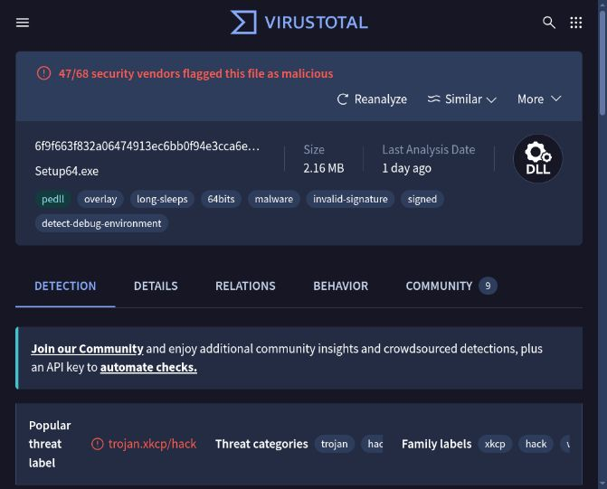

**F001-virustotal-propiedades.jpg** — captura externa real. Captura UTC: 2026-10-23T17:43:22.805301+00:00.

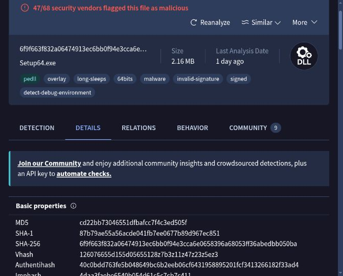

#### F002

**F002-virustotal-detecciones.jpg** — captura externa real. Captura UTC: 2026-10-23T17:43:52.974256+00:00.

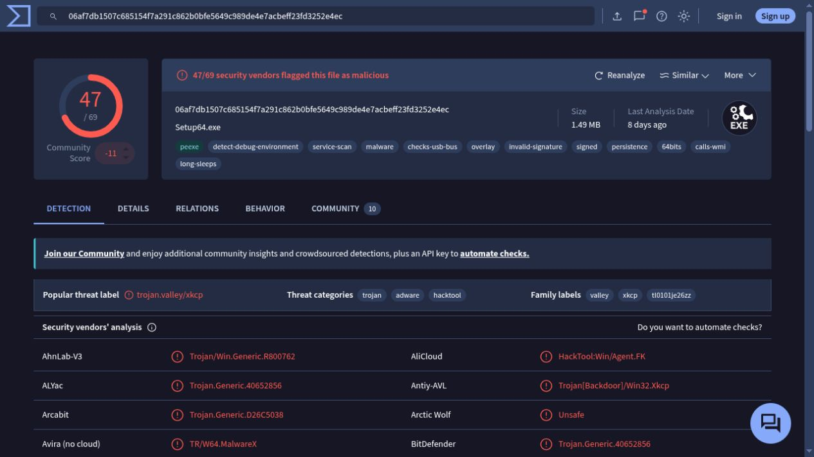

**Fechas y nombres observados** — captura externa real. Captura UTC: 2026-10-23T17:51:34.953140+00:00.

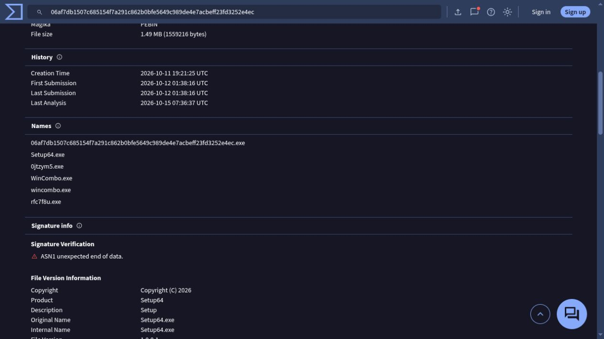

**Huellas, tipo, tamaño y fechas** — captura externa real. Captura UTC: 2026-10-23T17:51:43.833273+00:00.

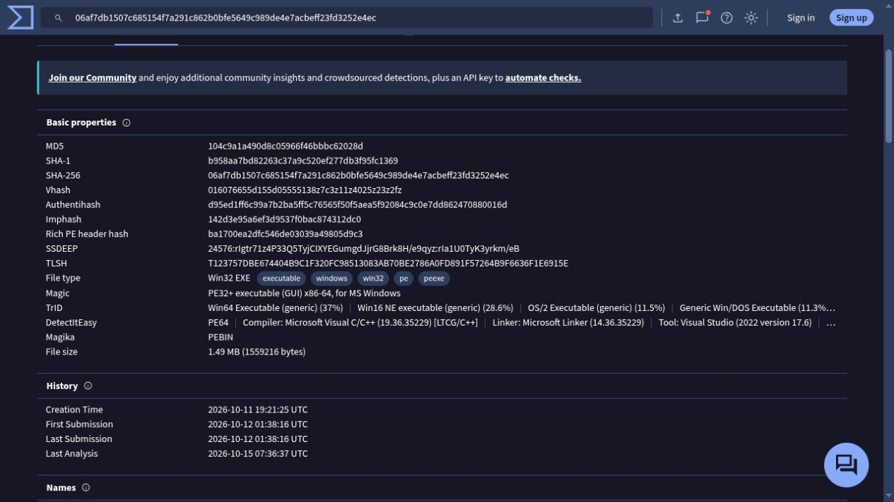

## Grupo 05 — fichas de correos

### Procedimiento y límites

Análisis estático dentro de la VM aislada sin red. No se ejecutaron muestras ni se renderizó HTML, cargaron imágenes, abrieron enlaces o solicitaron nuevos escaneos. MIME/quoted-printable se decodificó como datos. Se exportaron texto, cabeceras, estructura y hashes; no los EML completos ni binarios. La integridad de la exportación por consola se comprobó con SHA-256.

El parser instalado en la VM informa versión 1.1.0; no se atribuye este análisis local a la versión 1.2.0 del host. Las tres huellas de cada EML se toman del inventario estático previo y el SHA-256 se volvió a contrastar. Los resúmenes HTML son extracción de etiquetas/texto, no capturas de cómo se verían los mensajes.

Las cabeceras Authentication-Results y Received son declaraciones del archivo cuya confianza de origen no se ha establecido. No se revalidaron firmas DKIM ni SPF contra DNS histórico. Los registros DNS actuales no reconstruyen necesariamente la autenticación de julio. Los campos pass/none se transcriben sin convertir none en fail.

Para DMARC se distingue autenticación de alineación: un DKIM pass de otro dominio no basta para validar el dominio From; SPF aprobado y alineado puede respaldar DMARC. El análisis de contenido está fuera del alcance de DMARC. Referencia técnica: [RFC 9989, secciones 2.2 y 4.4](https://www.rfc-editor.org/rfc/rfc9989.html).

Evidencias: [análisis estático](correos-estaticos.json), [estructura HTML](correos-html-resumen.json), [reputación de remitentes/IP](correos-reputacion.json), [reputación de enlaces](enlaces-correo-reputacion.json). Los indicadores de este documento se muestran neutralizados.

### R004 — sample-10070.eml

**Clasificación consolidada: MALICIOSO. Confianza: media.** No hay evidencia suficiente para atribuir robo de credenciales, entrega de malware o infección del destinatario.

- Asunto: `Say goodbye to sharp, stabbing pains today!`.
- SHA-256: `511e3e59b9ca1947df591e15da12aed9813b811ace03e7a28aa70e116de878e4`.
- MD5: `6f67d861f68328504fc8fe10859dde98`.
- SHA-1: `f3896d7ef15586eabc1d5f99e41104a6ff096e8f`.
- Tamaño: 12294 bytes.
- From: `Knee Relief Alert <renewzl429@ginnybedellphotography[.]com>`.
- Return-Path: `renewlljwzs@ginnybedellphotography[.]com`.
- Reply-To: `replyto@brendamurphyrealestate[.]com`.
- Fecha declarada: `Thu, 02 Jul 2026 17:08:05 +0000`.
- Adjuntos: 0. No corresponde análisis de macros de adjuntos en estos mensajes.

#### Autenticación y transporte

Declaración literal: `spf=pass (sender IP is 20[.]169[.]217[.]199) smtp[.]mailfrom=ginnybedellphotography[.]com; dkim=pass (signature was verified) header[.]d=associationlienservices[.]com;dmarc=pass action=none header[.]from=ginnybedellphotography[.]com;compauth=pass reason=100`.

From y Return-Path comparten dominio: la alineación SPF declarada es compatible con el DMARC pass incluido. El dominio DKIM `associationlienservices[.]com` difiere del From: esa firma por sí sola no está alineada. Reply-To usa `brendamurphyrealestate[.]com`, un tercer dominio; el enlace mailto de baja apunta además a `vresan[.]com`. Son diferencias que requieren contexto, no prueba autónoma de suplantación.

El salto público de entrada a protección de correo declara `20[.]169[.]217[.]199` con HELO `associationlienservices[.]com`. Es la IP de entrega observada en la cadena, no una identificación del autor. Los saltos posteriores declaran infraestructura Outlook. El encabezado Date es del 2 de julio y Received del 6 de julio: se registra la diferencia sin inferir su causa.

#### Contenido y señales

Promoción de alivio de dolor de rodilla que invoca a un investigador de Harvard; esa afirmación no fue verificada. Incluye dos destinos acortados de shorturl y un recurso de imagen de 1×1 píxeles en `pnreap[.]com`, compatible con seguimiento de apertura. No se cargó. Las dos URLs acortadas tienen dos alertas maliciosas cada una en la consulta guardada; no se confirmó su destino final. La combinación respalda sospecha de spam o contenido engañoso, no una familia de malware.

#### Reputación consultada

- VirusTotal / `ginnybedellphotography[.]com`: **found**; 1 maliciosos, 0 sospechosos, 53 harmless, 38 undetected; alertas Chong Lua Dao: malicious; fecha del análisis guardado (epoch UTC): 1791795871. Consulta UTC: 2026-10-23T17:36:30+00:00.
- VirusTotal / `20[.]169[.]217[.]199`: **found**; 0 maliciosos, 0 sospechosos, 0 harmless, 92 undetected; fecha del análisis guardado (epoch UTC): 1792191711. Consulta UTC: 2026-10-23T17:36:47+00:00.
- VirusTotal / `hxxps://shorturl[.]at/zEbf9`: **found**; 2 maliciosos, 0 sospechosos, 60 harmless, 31 undetected; alertas Chong Lua Dao: malicious; SafeToOpen: phishing; fecha del análisis guardado (epoch UTC): 1792191681. Consulta UTC: 2026-10-23T17:37:50+00:00.
- urlscan.io / `hxxps://shorturl[.]at/zEbf9`: **no_results**; resultados históricos devueltos: 0. Consulta UTC: 2026-10-23T17:37:51+00:00.
- VirusTotal / `hxxps://shorturl[.]at/8IYrs`: **found**; 2 maliciosos, 0 sospechosos, 59 harmless, 32 undetected; alertas Chong Lua Dao: malicious; SafeToOpen: phishing; fecha del análisis guardado (epoch UTC): 1792191681. Consulta UTC: 2026-10-23T17:38:08+00:00.
- urlscan.io / `hxxps://shorturl[.]at/8IYrs`: **no_results**; resultados históricos devueltos: 0. Consulta UTC: 2026-10-23T17:38:09+00:00.

La reputación actual de una IP de infraestructura compartida no califica el mensaje como limpio. no_results no significa dominio inexistente ni inocuo; undetected no representa un resultado de seguridad afirmativo. Se conserva la cobertura de los motores de VirusTotal; la consulta dedicada posterior de MXToolbox se documenta en la actualización de cierre. Las respuestas históricas de urlscan no prueban cómo se comportan hoy todos los enlaces.

#### Ampliación verificada de R004

La URL exacta del recurso remoto de 1×1 en `pnreap[.]com` aparece en el HTML del EML y en la tabla del informe independiente. La consulta de corroboración registra **12 motores maliciosos y 1 sospechoso** para esa URL, no solo para su dominio. Último análisis de VT: 2026-10-16T23:01:21+00:00. La consulta actual se conserva con su propia fecha UTC.

El informe existente de VT conserva una cadena HTTP/HTTPS que termina en `hxxps://www[.]google[.]com/`. Ese destino final no vuelve inocuo el recurso de origen ni prueba robo de credenciales. La clasificación del correo se limita a spam con un recurso remoto de reputación maliciosa; no se demuestra ejecución de malware, infección ni captura de contraseñas. La confianza permanece media por el papel de seguimiento del recurso y la ausencia de observación de una captación de datos.

[Consulta de corroboración URL y dominio](consolidacion/pnreap-verificacion.json). El intento de recuperar el detalle del escaneo previo unlisted devolvió `response_too_large`; se conserva [ese resultado](consolidacion/pnreap-urlscan-previo.json) y no se presenta como un informe íntegro recuperado. La redirección citada aquí proviene del reporte VT que sí se obtuvo.

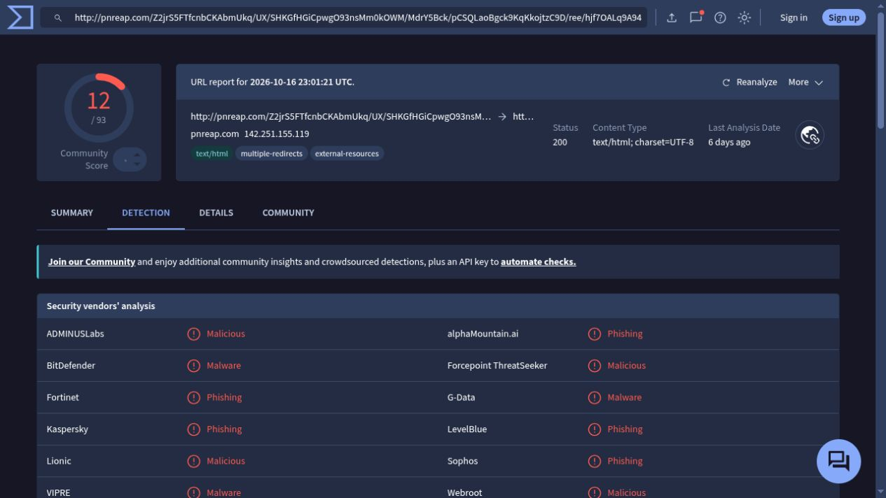

#### Impacto y medidas

**Confidencialidad:** riesgo potencial de seguimiento y de revelar datos al responder/interactuar. No se observó exfiltración. **Integridad:** no se observaron cambios; un posible engaño que induzca acciones del usuario requiere más evidencia. **Disponibilidad:** sin impacto demostrado.

**Medida para el usuario:** no interactuar, no cargar imágenes remotas ni usar enlaces de baja del mensaje; reportarlo como sospechoso. **Control organizacional propuesto:** filtrar spam/enlaces, revisar autenticación y alineación con otras señales, desactivar carga automática de recursos remotos cuando corresponda y revisar mensajes similares. No bloquear rangos enteros de proveedores compartidos por este caso.

### R005 — sample-10071.eml

**Clasificación propuesta: SOSPECHOSO. Confianza: media.** No hay evidencia suficiente para atribuir robo de credenciales, entrega de malware o infección del destinatario.

- Asunto: `100 Balls[.] $5 No Deposit Required !`.
- SHA-256: `43cbe639b7ce04294b5f11ef5daf2a5acf8d7b5e2a057fe699e071251a4f0fb8`.
- MD5: `09831e7fb7b600104d0c3a6aae054379`.
- SHA-1: `114537dded5d8ada673a8efef5de874a846064a1`.
- Tamaño: 465737 bytes.
- From: `free spin <taylor[.]flores@ezagameroasin02[.]onmicrosoft[.]com>`.
- Return-Path: `taylor[.]flores@ezagameroasin02[.]onmicrosoft[.]com`.
- Reply-To: ausente.
- Fecha declarada: `Mon, 06 Jul 2026 15:53:28 -0700`.
- Adjuntos: 0. No corresponde análisis de macros de adjuntos en estos mensajes.

#### Autenticación y transporte

Declaración literal: `spf=none (sender IP is 209[.]85[.]167[.]46) smtp[.]mailfrom=ezagameroasin02[.]onmicrosoft[.]com; dkim=pass (signature was verified) header[.]d=ezagameroasin02-onmicrosoft-com[.]20251104[.]gappssmtp[.]com;dmarc=none action=none header[.]from=ezagameroasin02[.]onmicrosoft[.]com;`.

From y Return-Path comparten `ezagameroasin02[.]onmicrosoft[.]com`. La cabecera declara SPF none y DMARC none; eso no equivale a fail. DKIM figura pass con `d=ezagameroasin02-onmicrosoft-com[.]20251104[.]gappssmtp[.]com`, distinto del dominio From; no hay alineación DKIM visible para ese From.

La IP pública de entrega a protección de correo es `209[.]85[.]167[.]46`, con nombre declarado `mail-lf1-f46[.]google[.]com`. También hay líneas que mencionan gmailapi/HTTPREST; no identifican una IP original del usuario. No se atribuye el envío a Google ni Microsoft como autores por usar su infraestructura.

#### Contenido y señales

Promoción de Plinko con promesa de premios de hasta un millón de dólares y oferta de 100 bolas por 5 dólares. El HTML contiene gran cantidad de texto alfanumérico largo y al menos un elemento con display:none; se registra como relleno/ocultamiento, sin afirmar que sea un programa o una carga ejecutable. Los tres enlaces de acción/baja apuntan a `woondsplay[.]com`. Hay una imagen 1×1 en ese dominio compatible con seguimiento. Otro src contiene el destinatario antes de @: no se consultó ni cargó esa URL.

La falta de autenticación alineada declarada, la oferta y los enlaces externos justifican cautela. No se verificó un formulario de credenciales ni un pago real; no se afirma phishing confirmado.

#### Reputación consultada

- VirusTotal / `ezagameroasin02[.]onmicrosoft[.]com`: **no_results**. Consulta UTC: 2026-10-23T17:37:04+00:00.
- VirusTotal / `209[.]85[.]167[.]46`: **found**; 0 maliciosos, 0 sospechosos, 56 harmless, 36 undetected; fecha del análisis guardado (epoch UTC): 1792767412. Consulta UTC: 2026-10-23T17:37:21+00:00.
- VirusTotal / `woondsplay[.]com`: **found**; 7 maliciosos, 2 sospechosos, 50 harmless, 33 undetected; alertas alphaMountain[.]ai: phishing; Bkav: malicious; CRDF: malicious; ESET: suspicious; Forcepoint ThreatSeeker: spam; Fortinet: phishing; Seclookup: malicious; SOCRadar: malicious; Webroot: malicious; fecha del análisis guardado (epoch UTC): 1792750493. Consulta UTC: 2026-10-23T17:38:25+00:00.
- urlscan.io / `woondsplay[.]com`: **no_results**; resultados históricos devueltos: 0. Consulta UTC: 2026-10-23T17:38:26+00:00.

La reputación actual de una IP de infraestructura compartida no califica el mensaje como limpio. no_results no significa dominio inexistente ni inocuo; undetected no representa un resultado de seguridad afirmativo. Se conserva la cobertura de los motores de VirusTotal; la consulta dedicada posterior de MXToolbox se documenta en la actualización de cierre. Las respuestas históricas de urlscan no prueban cómo se comportan hoy todos los enlaces.

#### Impacto y medidas

**Confidencialidad:** riesgo potencial de seguimiento y de revelar datos al responder/interactuar. No se observó exfiltración. **Integridad:** no se observaron cambios; un posible engaño que induzca acciones del usuario requiere más evidencia. **Disponibilidad:** sin impacto demostrado.

**Medida para el usuario:** no interactuar, no cargar imágenes remotas ni usar enlaces de baja del mensaje; reportarlo como sospechoso. **Control organizacional propuesto:** filtrar spam/enlaces, revisar autenticación y alineación con otras señales, desactivar carga automática de recursos remotos cuando corresponda y revisar mensajes similares. No bloquear rangos enteros de proveedores compartidos por este caso.

### Alcance del cierre de correos

Las listas antispam y las evidencias históricas adicionales se incorporan a continuación y en el inventario complementario. No se visitaron los destinos ni se solicitaron nuevos escaneos durante la consolidación. Los dos binarios F001/F002 no se atribuyen a estos correos, ya que ninguno contiene adjuntos.

### Evidencia visual incorporada

Las imágenes se capturaron después de las consultas API. La fecha del último análisis del proveedor no es la fecha de captura. Los JSON y registros originales se conservan como fuente de detalle. [Registro de capturas](capturas/registro-capturas.json).

#### R004

**R004-cabeceras-local.jpg** — captura de vista local derivada. Captura UTC: 2026-10-23T17:52:53.927069+00:00.

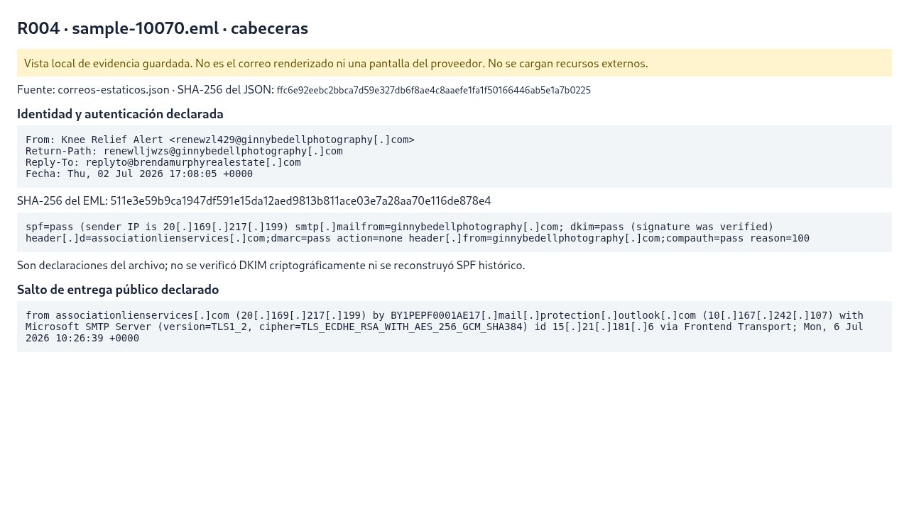

**R004-consultas-local-continuacion.jpg** — captura de vista local derivada. Captura UTC: 2026-10-23T17:53:40.365556+00:00.

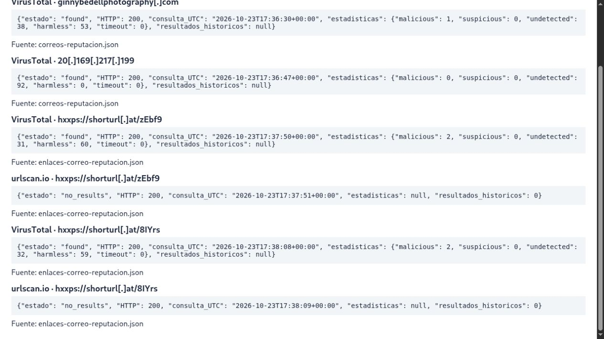

**R004-consultas-local.jpg** — captura de vista local derivada. Captura UTC: 2026-10-23T17:53:16.610290+00:00.

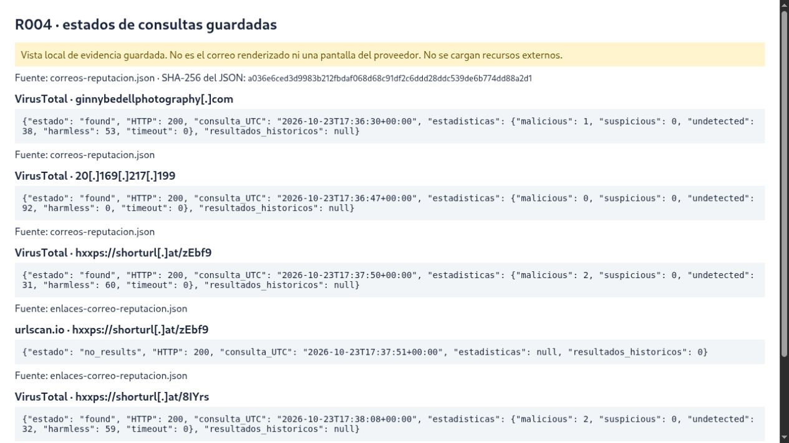

**Primer enlace acortado: dos alertas** — captura externa real. Captura UTC: 2026-10-23T17:53:14.370364+00:00.

**Segundo enlace acortado: dos alertas** — captura externa real. Captura UTC: 2026-10-23T17:53:37.833630+00:00.

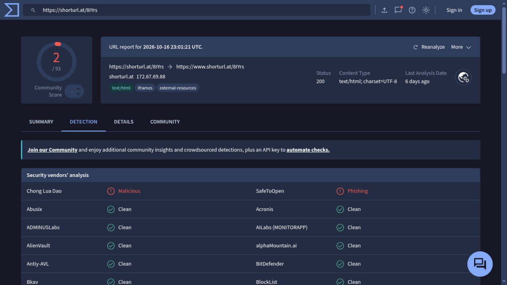

**IP de entrega; sin detecciones, no demuestra legitimidad** — captura externa real. Captura UTC: 2026-10-23T17:54:44.635928+00:00.

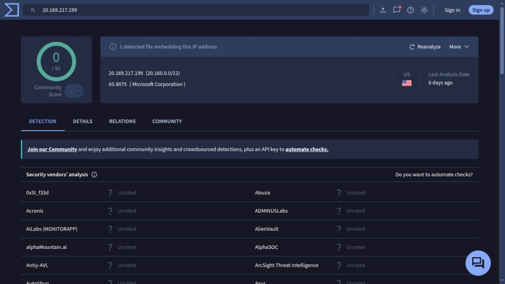

**R004-mime-enlaces-local.jpg** — captura de vista local derivada. Captura UTC: 2026-10-23T17:52:54.555047+00:00.

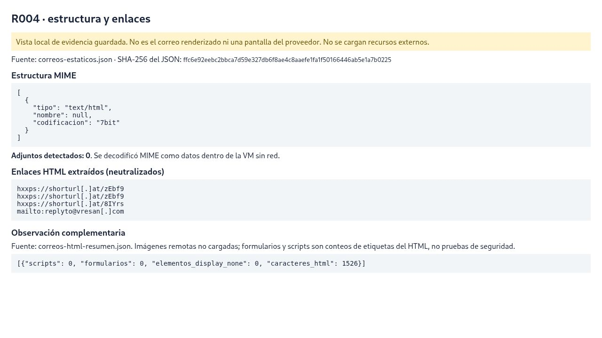

**Reputación del dominio remitente: una detección** — captura externa real. Captura UTC: 2026-10-23T17:54:12.524680+00:00.

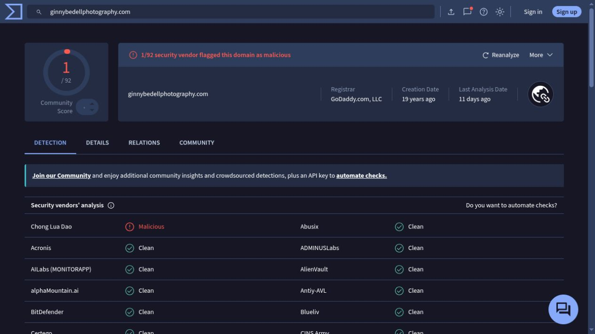

#### R005

**R005-cabeceras-local.jpg** — captura de vista local derivada. Captura UTC: 2026-10-23T17:52:54.283056+00:00.

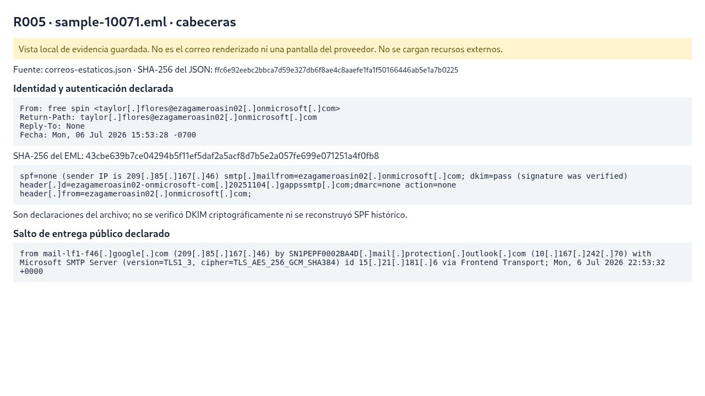

**R005-consultas-local.jpg** — captura de vista local derivada. Captura UTC: 2026-10-23T17:53:16.982278+00:00.

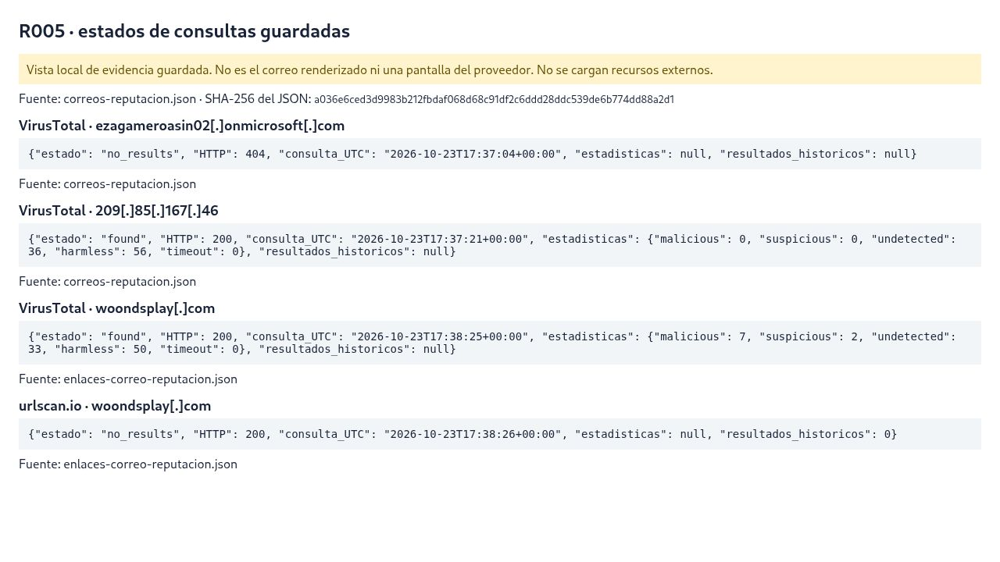

**Dominio de los enlaces: detecciones maliciosas y sospechosas** — captura externa real. Captura UTC: 2026-10-23T17:52:33.487842+00:00.

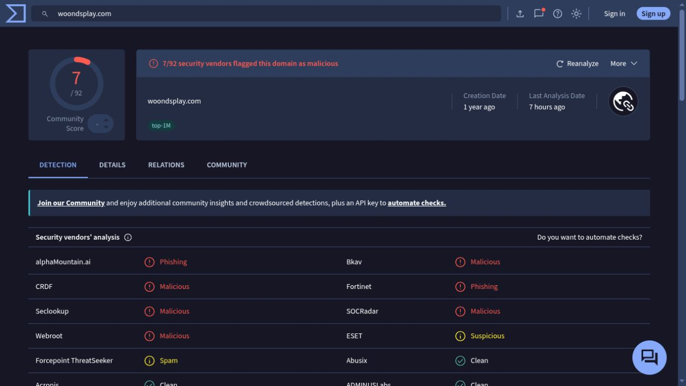

**IP de entrega; sin detecciones, no demuestra legitimidad** — captura externa real. Captura UTC: 2026-10-23T18:03:46.849621+00:00.

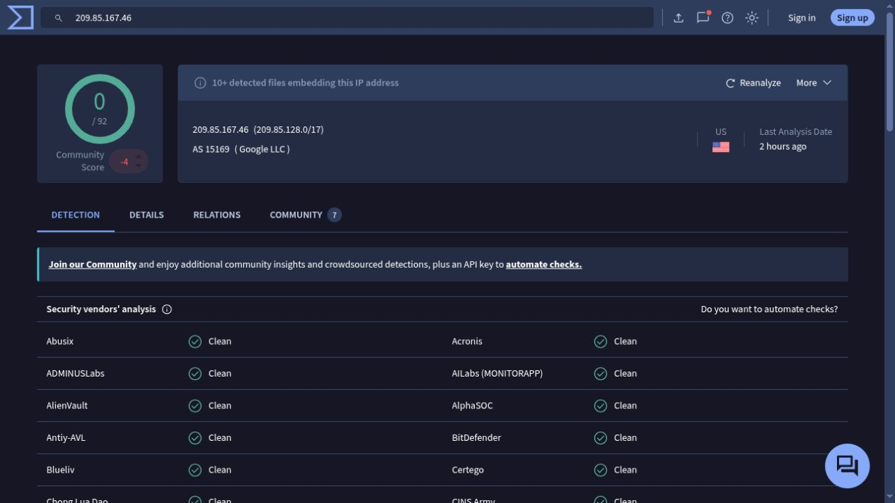

**R005-mime-enlaces-local.jpg** — captura de vista local derivada. Captura UTC: 2026-10-23T17:52:54.823037+00:00.

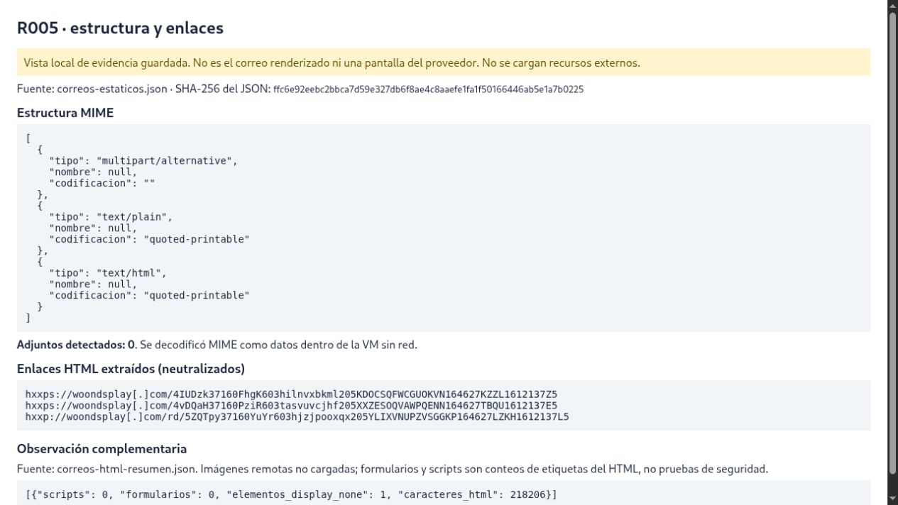

#### Precisiones y límites de evidencia

Las vistas locales muestran campos de los JSON preservados; no son nuevas verificaciones de autenticación ni capturas de los EML abiertos. El texto From/Return-Path/Reply-To y Authentication-Results sigue disponible completo en correos-estaticos.json. Las vistas no contienen el cuerpo HTML original ni recursos remotos.

En los dos enlaces acortados, el informe guardado de VirusTotal registra redirection_chain desde shorturl[.]at a www[.]shorturl[.]at, con last_http_response_code 200. Eso respalda únicamente el salto histórico al subdominio www; no permite afirmar que se haya identificado el destino malicioso final de la campaña.

Las imágenes de las IP también muestran referencias a archivos que contienen esas IP: esa relación no demuestra autoría, infección ni maliciosidad de los mensajes. La ausencia de resultados de urlscan y del dominio remitente de R005 está respaldada por las respuestas originales y sus vistas locales; no se sustituye por una pantalla externa inventada.

Persisten como pendientes analíticos la verificación independiente de autenticación y comportamiento/destino final de los enlaces. No se presentan como tareas completadas.

### Actualización de cierre — listas antispam y búsqueda exacta

Se completó la consulta dedicada en MXToolbox para las dos IP públicas de entrega: R004 / 20[.]169[.]217[.]199, 0 listados y 1 timeout entre 60 listas; R005 / 209[.]85[.]167[.]46, 0 listados y 0 timeouts entre 60 listas. Es el resultado de la consulta actual, no una reconstrucción de julio ni prueba de legitimidad del mensaje. No se interpreta el timeout como resultado negativo.

[Registro de adquisición](cierre/mxtoolbox-adquisicion.json), [salida textual R004](cierre/R004-mxtoolbox-texto.txt), [salida textual R005](cierre/R005-mxtoolbox-texto.txt). Las salidas de texto son extracciones del árbol accesible del navegador, no respuestas de una API de MXToolbox. Se omitió en el texto el pie «Your IP» del equipo consultante.

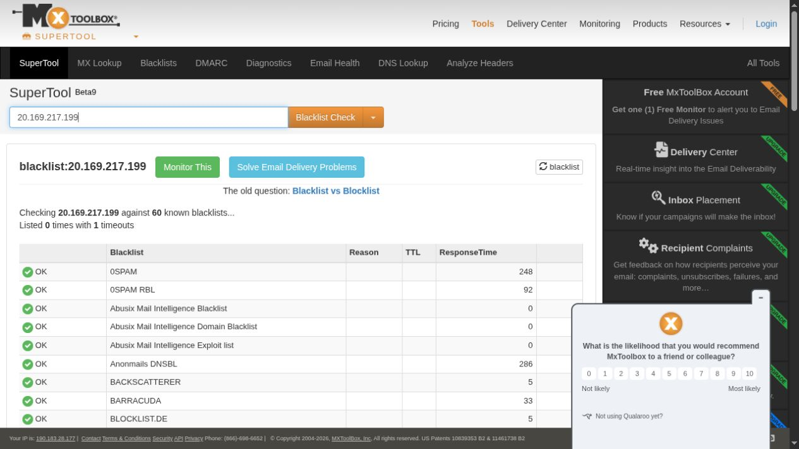

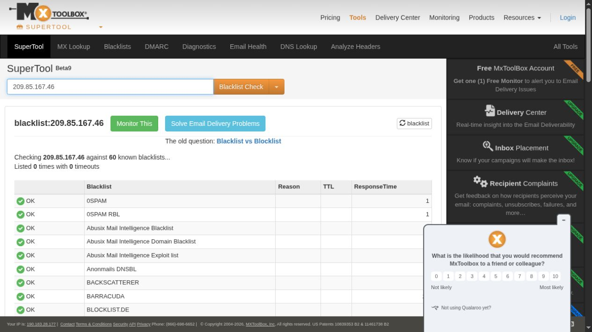

Se repitieron las búsquedas de los cinco enlaces HTTP(S) de correo con `task.url.keyword`, conservando la URL exacta. Ninguna devolvió resultados en esta adquisición. [Respuestas completas de la revisión](cierre/urlscan-correo-revision-exacta.json). Se preservaron las búsquedas iniciales para documentar el cambio de campo; no se concluye que jamás haya existido un escaneo o que el enlace sea inocuo.

La revisión de MXToolbox no modifica por sí sola los veredictos. La ampliación de evidencias de pnreap se refleja en la clasificación consolidada de R004; R005 permanece sospechoso. El destino posterior de las URLs acortadas y la autenticidad histórica independiente siguen sin confirmarse. El reporte VT separado del recurso pnreap se describe en la ampliación de R004.

## Grupo 05 — fichas de las tres URLs

### Alcance y procedencia

Las tres URLs provienen de R006 / url.txt, SHA-256 `972f6f2322a6bce4e1adfdfea8fde8d0d76f357a8855c064e8cc0c734cd91125`. Se consultaron informes y datos públicos existentes; no se visitaron destinos sospechosos, descargaron cargas ni solicitaron escaneos nuevos. Las IP, HTTP y contenidos históricos son observaciones de terceros del 16/10/2026, distintas del estado DNS/registral consultado el 23/10/2026.

Las búsquedas exactas con canonical.page.url no devolvieron resultados. Se amplió al host/IP y se seleccionaron localmente únicamente task.url idénticos a la URL del recurso. No se atribuyen al recurso los resultados de otras rutas de la misma IP. Se conserva la búsqueda vacía y la ampliada. La ausencia inicial no demuestra ausencia de históricos. El detalle U001 sin clave respondió 403; una consulta posterior autenticada tuvo éxito.

Los veredictos urlscan son discordantes: overall.malicious=false y urlscan.hasVerdicts=false en los tres reportes; el bloque engines informa malicious=true para U001/U003 y false para U002. Se preservan todas las señales y no se traduce false/sin clasificación a limpio. Las detecciones de VT no son votos estadísticamente independientes.

[Resumen normalizado con referencias](urls/20261023T180740Z/resumen-normalizado.json). [Registro de capturas](capturas/registro-capturas.json).

### U001 — `hxxps://g-comeceseuatendimenton[.]shop/`

**Clasificación propuesta: SOSPECHOSO. Confianza: Media.**

Fuentes: [consultas originales](urls/20261023T180740Z/U001.json), [informe detallado histórico](urls/20261023T180740Z/U001-urlscan-detalle-autenticado-01a1462b-bbda-773d-a9b2-fa0511ed4b52.json). Adquisición UTC: 2026-10-23T18:07:40.710075+00:00.

#### Reputación y observación histórica

- VT de la URL exacta: {"malicious": 2, "suspicious": 0, "undetected": 36, "harmless": 55, "timeout": 0}. Último análisis UTC: 2026-10-16T20:33:02+00:00.
- Etiquetas de motores: `ESET: phishing`, `LevelBlue: phishing`.
- urlscan: 2026-10-16T19:24:00.159Z; título `Consulta de Informações Financeiras`; IP `88[.]80[.]17[.]232`; país informado SE; HTTP 200. La geolocalización no identifica al operador.
- Dominios contactados por el escaneo: `g-comeceseuatendimenton[.]shop`, `fonts[.]gstatic[.]com`, `ipapi[.]co`, `fonts[.]googleapis[.]com`. No implica que todos sean maliciosos.
- Redirecciones: lista vacía en el detalle urlscan; VT informa URL final `hxxps://g-comeceseuatendimenton[.]shop/`. Esto describe esos reportes, no garantiza ausencia de redirecciones en otro momento.

La captura archivada muestra una oferta de orientación sobre información de CPF con temporizador y botón “Acessar orientações”. Incluye avisos de contenido educativo y de no ser institución financiera; esas afirmaciones pertenecen al sitio y no se validaron. No se observa en esa captura un formulario para introducir credenciales. El detalle registra un enlace saliente hacia `hxxps://feiraoaberto[.]netlify[.]app/login/`: un enlace no es una redirección ni prueba de envío de datos. No se siguió.

Dos motores de VT etiquetan phishing; el título/temática y el enlace saliente sostienen sospecha de ingeniería social. No se confirma captación de credenciales, exfiltración ni una entidad suplantada.

#### Registro, DNS y certificados

- Registro: 2026-07-29T13:23:01.0Z; antigüedad aproximada a la consulta: 86 días. Registrar: Dynadot Inc.
- Estados RDAP: `server hold`, `client transfer prohibited`.
- NS según RDAP: `ns1[.]dyna-ns[.]net`, `ns2[.]dyna-ns[.]net`.
- DNS actual: RCODE 3 (NXDOMAIN) en los tipos consultados. No se presenta como limpio ni contradice la existencia de históricos. No se atribuye una causa de suspensión; los estados hold/inactive se conservan como contexto.
- Nombres observados en CT: `g-comeceseuatendimenton[.]shop`.

  Certificado/entrada 28359107479: `g-comeceseuatendimenton[.]shop`; 2026-07-29T18:47:32 a 2026-10-27T18:47:31; emisor `C=US, O=Let's Encrypt, CN=YR2`.
  Certificado/entrada 28359104673: `g-comeceseuatendimenton[.]shop`; 2026-07-29T18:47:32 a 2026-10-27T18:47:31; emisor `C=US, O=Let's Encrypt, CN=YR2`.

Las entradas duplicadas de pre-certificado/certificado no cuentan como dominios distintos. El registro CT no prueba que el servidor actual use ese certificado ni que el sitio sea legítimo. La vigencia anotada es la declarada por la entrada; no se probó una conexión TLS al destino. Para U001 se conservó el timeout inicial y luego se obtuvo la consulta de subdominios.

Certificado principal según el histórico urlscan: g-comeceseuatendimenton.shop, emisor YR1; válido de 2026-09-25T22:34:26+00:00 a 2026-12-24T22:34:25+00:00. Es una observación de ese escaneo y puede diferir de las entradas CT enumeradas; no se verificó el certificado actual ni se infiere legitimidad.

#### Impacto y medidas

**Confidencialidad potencial:** riesgo de revelar información al interactuar con un recurso sospechoso o su destino enlazado; no se observó envío de credenciales. **Integridad/disponibilidad:** sin efecto demostrado. **Usuario:** evitar interacción y verificar por un canal oficial independiente. **Organización:** aplicar filtrado y revisión contextual de indicadores; no bloquear dominios de infraestructura compartida por aparecer como recursos de terceros.

#### Evidencia visual

captura de vista local derivada. Captura UTC: 2026-10-23T18:15:49.369277+00:00.

captura de vista local derivada. Captura UTC: 2026-10-23T18:15:48.813274+00:00.

captura de imagen histórica de tercero. Captura UTC: 2026-10-23T18:10:20.158327+00:00.

captura externa real. Captura UTC: 2026-10-23T18:09:43.386198+00:00.

captura externa real. Captura UTC: 2026-10-23T18:09:05.390073+00:00.

Los JPEG son capturas reales del navegador. Los que terminan en “local” muestran datos derivados de JSON y lo indican en pantalla; no son imágenes del proveedor ni del sitio. Las imágenes “archivada” corresponden a capturas ya existentes de urlscan, no a visitas actuales.

### U002 — `hxxp://221[.]15[.]173[.]51:41661/bin[.]sh`

**Clasificación propuesta: MALICIOSO. Confianza: Alta en reputación y asociación histórica al binario; sin ejecución propia.**

Fuentes: [consultas originales](urls/20261023T180740Z/U002.json), [informe detallado histórico](urls/20261023T180740Z/U002-urlscan-detalle-autenticado-01a1464c-f4e2-70ba-8c0c-131c9851a684.json). Adquisición UTC: 2026-10-23T18:08:05.447916+00:00.

#### Reputación y observación histórica

- VT de la URL exacta: {"malicious": 4, "suspicious": 3, "undetected": 33, "harmless": 53, "timeout": 0}. Último análisis UTC: 2026-10-16T19:48:07+00:00.
- Etiquetas de motores: `alphaMountain[.]ai: suspicious`, `Emsisoft: malware`, `Fortinet: malware`, `GreyNoise: malicious`, `Gridinsoft: suspicious`, `SOCRadar: suspicious`, `Webroot: malicious`.
- urlscan: 2026-10-16T20:00:43.057Z; título no informado; IP `221[.]15[.]173[.]51`; país informado CN; HTTP 200. La geolocalización no identifica al operador.
- Dominios contactados por el escaneo: ninguno; acceso a IP literal. No implica que todos sean maliciosos.
- Redirecciones: lista vacía en el detalle urlscan; VT informa URL final `hxxp://221[.]15[.]173[.]51:41661/bin[.]sh`. Esto describe esos reportes, no garantiza ausencia de redirecciones en otro momento.

El histórico documenta una descarga completada llamada `bin.sh`: 137480 bytes, descrita como **ELF 32-bit MIPS**, no como script shell. El MIME HTTP reportado como application/zip no determina el formato real. El SHA-256 de descarga coincide con el hash de contenido HTTP de VT y con un informe de archivo separado:

`f6c97b1e2ed02578ca1066c8235ba4f991e645f89012406c639dbccc6582eec8`

Ese informe existente informa **50 motores maliciosos**, tipo ELF y tamaño idéntico. Etiqueta popular: `trojan.mirai/mozi`; son atribuciones del servicio, no una familia determinada mediante análisis propio. La combinación de descarga histórica, identidad por hash y reputación respalda clasificación maliciosa con alta confianza. No se descargó ni ejecutó ese binario; tampoco pertenece a los dos Windows PE del ZIP.

[Reputación del hash asociado](urls/20261023T180740Z/U002-archivo-reputacion.json). Último análisis del archivo UTC: 2026-10-13T21:17:41+00:00. No se deducen procesos, persistencia o DDoS ejecutados a partir de esas etiquetas.

#### Registro, DNS y certificados

La URL usa una IP literal por HTTP y puerto 41661. Antigüedad/registrador/NS de dominio y certificados HTTPS de dominio no aplican a este recurso. El RDAP de red registra `UNICOM-HA`, país CN, bloque `221[.]13[.]128[.]0`–`221[.]15[.]255[.]255`. Su fecha de asignación 2008-09-04T06:52:49Z no equivale a antigüedad de una campaña.

#### Impacto y medidas

**C-I-A potencial:** la distribución de un ejecutable con reputación maliciosa supone riesgo para integridad y confidencialidad si llega a ejecutarse en un sistema compatible. Las etiquetas de botnet/DDoS justifican evaluar disponibilidad como hipótesis, sin afirmar ataques observados. **Usuario:** no descargar ni ejecutar. **Organización:** bloquear URL/hash y revisar telemetría de accesos o descargas; investigar solo si hay indicios de afectación.

#### Evidencia visual

captura de vista local derivada. Captura UTC: 2026-10-23T18:16:30.826627+00:00.

captura externa real. Captura UTC: 2026-10-23T18:12:57.786950+00:00.

captura externa real. Captura UTC: 2026-10-23T18:11:21.878559+00:00.

captura externa real. Captura UTC: 2026-10-23T18:12:55.714941+00:00.

captura externa real. Captura UTC: 2026-10-23T18:11:14.990532+00:00.

Los JPEG son capturas reales del navegador. Los que terminan en “local” muestran datos derivados de JSON y lo indican en pantalla; no son imágenes del proveedor ni del sitio. Las imágenes “archivada” corresponden a capturas ya existentes de urlscan, no a visitas actuales.

### U003 — `hxxps://www[.]pneustorebr[.]cfd/`

**Clasificación propuesta: SOSPECHOSO. Confianza: Media.**

Fuentes: [consultas originales](urls/20261023T180740Z/U003.json), [informe detallado histórico](urls/20261023T180740Z/U003-urlscan-detalle-autenticado-01a1460d-11c6-71b9-9818-3caec90d10c7.json). Adquisición UTC: 2026-10-23T18:08:38.818631+00:00.

#### Reputación y observación histórica

- VT de la URL exacta: {"malicious": 1, "suspicious": 0, "undetected": 35, "harmless": 57, "timeout": 0}. Último análisis UTC: 2026-10-16T20:47:16+00:00.
- Etiquetas de motores: `ESET: phishing`.
- urlscan: 2026-10-16T18:50:34.640Z; título `Domain registered \| Dynadot`; IP `54[.]215[.]31[.]113`; país informado US; HTTP 404. La geolocalización no identifica al operador.
- Dominios contactados por el escaneo: `widget[.]trustpilot[.]com`, `fonts[.]cdnfonts[.]com`, `www[.]pneustorebr[.]cfd`, `oss[.]dynadot[.]com`. No implica que todos sean maliciosos.
- Redirecciones: lista vacía en el detalle urlscan; VT informa URL final `hxxps://www[.]pneustorebr[.]cfd/`. Esto describe esos reportes, no garantiza ausencia de redirecciones en otro momento.

urlscan muestra una página de dominio aparcado “Domain registered | Dynadot” y HTTP 404. VT, en otro horario, reporta HTTP 200 y una IP distinta: se conservan ambos resultados sin inventar una causa. La URL exacta tiene una detección de phishing; el dominio raíz tiene seis maliciosas y dos sospechosas en su consulta separada. El dominio raíz no se confunde con la URL www.

No se observó en ese histórico una tienda ni un formulario de credenciales. El parecido del nombre con una marca no prueba suplantación. Se propone sospechoso por las alertas y el contexto; no se afirma fraude de una tienda demostrado por la página aparcada.

#### Registro, DNS y certificados

- Registro: 2026-09-04T03:47:46.0Z; antigüedad aproximada a la consulta: 49 días. Registrar: Dynadot Inc.
- Estados RDAP: `server transfer prohibited`, `client hold`, `client transfer prohibited`, `inactive`.
- NS según RDAP: no incluidos en la respuesta.
- DNS actual: RCODE 3 (NXDOMAIN) en los tipos consultados. No se presenta como limpio ni contradice la existencia de históricos. No se atribuye una causa de suspensión; los estados hold/inactive se conservan como contexto.
- Nombres observados en CT: `pneustorebr[.]cfd`, `www[.]pneustorebr[.]cfd`.

  Certificado/entrada 29336333368: `pneustorebr[.]cfd`; 2026-09-04T07:31:13 a 2026-12-03T07:31:12; emisor `C=US, O=Let's Encrypt, CN=YR2`.
  Certificado/entrada 29676156333: `pneustorebr[.]cfd`; 2026-09-04T07:31:13 a 2026-12-03T07:31:12; emisor `C=US, O=Let's Encrypt, CN=YR2`.
  Certificado/entrada 29336334494: `www[.]pneustorebr[.]cfd`; 2026-09-04T07:31:13 a 2026-12-03T07:31:12; emisor `C=US, O=Let's Encrypt, CN=YR1`.
  Certificado/entrada 29808327070: `www[.]pneustorebr[.]cfd`; 2026-09-04T07:31:13 a 2026-12-03T07:31:12; emisor `C=US, O=Let's Encrypt, CN=YR1`.

Las entradas duplicadas de pre-certificado/certificado no cuentan como dominios distintos. El registro CT no prueba que el servidor actual use ese certificado ni que el sitio sea legítimo. La vigencia anotada es la declarada por la entrada; no se probó una conexión TLS al destino. Para U001 se conservó el timeout inicial y luego se obtuvo la consulta de subdominios.

Certificado principal según el histórico urlscan: *.dynadot.com, emisor GlobalSign GCC R6 AlphaSSL CA 2025; válido de 2025-10-18T00:00:00+00:00 a 2026-11-18T23:59:59+00:00. Es una observación de ese escaneo y puede diferir de las entradas CT enumeradas; no se verificó el certificado actual ni se infiere legitimidad.

#### Impacto y medidas

**Confidencialidad potencial:** riesgo de revelar información al interactuar con un recurso sospechoso o su destino enlazado; no se observó envío de credenciales. **Integridad/disponibilidad:** sin efecto demostrado. **Usuario:** evitar interacción y verificar por un canal oficial independiente. **Organización:** aplicar filtrado y revisión contextual de indicadores; no bloquear dominios de infraestructura compartida por aparecer como recursos de terceros.

#### Evidencia visual

captura de vista local derivada. Captura UTC: 2026-10-23T18:15:50.221281+00:00.

captura de vista local derivada. Captura UTC: 2026-10-23T18:15:49.937280+00:00.

captura de imagen histórica de tercero. Captura UTC: 2026-10-23T18:12:18.842788+00:00.

captura externa real. Captura UTC: 2026-10-23T18:12:18.466786+00:00.

captura externa real. Captura UTC: 2026-10-23T18:17:10.546679+00:00.

captura externa real. Captura UTC: 2026-10-23T18:12:07.194740+00:00.

Los JPEG son capturas reales del navegador. Los que terminan en “local” muestran datos derivados de JSON y lo indican en pantalla; no son imágenes del proveedor ni del sitio. Las imágenes “archivada” corresponden a capturas ya existentes de urlscan, no a visitas actuales.

### Límites de este bloque

Los tres recursos fueron revisados con datos existentes. No se verificó el sitio actual ni se ejecutó contenido. No se siguió el enlace de login externo de U001. El archivo de U002 no se descargó. Los hallazgos no prueban infección del equipo ni autoría de operadores. Las diferencias de DNS, HTTP, IP, TLS y veredictos se conservan con su fecha y alcance.

## Inventario complementario de URLs de correo

El informe independiente amplía el inventario a **11 URLs HTTP(S) únicas**: enlaces y recursos `src` de imágenes. No son 11 recursos adicionales del set. Se contrastó su presencia con las extracciones estáticas propias, resolviendo las referencias de imagen `//` con el mismo esquema y eliminando duplicados.

Los resultados de 0 detecciones de imágenes se consignan como ausencia de confirmación maliciosa según la fuente aportada. No se trasladan como una demostración de legitimidad. En la URL de logo de R005, `phishing@` es userinfo y el host es `pot.efuserassets.com`; no se interpreta toda la cadena como un dominio de correo.

| ID | Correo | Papel | Indicador resumido y neutralizado | Evidencia y procedencia | Interpretación |
| :--- | :--- | :--- | :--- | :--- | :--- |
| C1-01 | R004 | Enlace | shorturl[.]at/zEbf9 | 2 detecciones en URL, consulta propia | Sospechoso |
| C1-02 | R004 | Imagen | i[.]imgur[.]com/jZaxBnA.png | 0 detecciones según TXT aportado | Sin confirmación maliciosa; no legítimo acreditado |
| C1-03 | R004 | Enlace | shorturl[.]at/8IYrs | 2 detecciones en URL, consulta propia | Sospechoso |
| C1-04 | R004 | Imagen | i[.]imgur[.]com/OOaNe2w.png | 0 detecciones según TXT aportado | Sin confirmación maliciosa; no legítimo acreditado |
| C1-05 | R004 | Recurso 1×1 | pnreap[.]com/[ruta de seguimiento] | 12 maliciosos y 1 sospechoso en URL exacta; corroborado | Reputación maliciosa |
| C2-01 | R005 | Enlace | woondsplay[.]com/[ruta 1] | Sin informe URL según TXT; dominio con 7 maliciosos | Sospechoso |
| C2-02 | R005 | Enlace | woondsplay[.]com/[ruta 2] | Sin informe URL según TXT; dominio con 7 maliciosos | Sospechoso |
| C2-03 | R005 | Enlace/baja | woondsplay[.]com/rd/[ruta] | Sin informe URL según TXT; dominio con 7 maliciosos | Sospechoso |
| C2-04 | R005 | Imagen | hxxps://phishing@pot.efuserassets[.]com/.../logo.png | Sin informe URL; 0 en dominio según TXT | Sin confirmación maliciosa; no legítimo acreditado |
| C2-05 | R005 | Imagen | i[.]imgur[.]com/l5706eG.png | 0 detecciones según TXT aportado | Sin confirmación maliciosa; no legítimo acreditado |
| C2-06 | R005 | Recurso 1×1 | woondsplay[.]com/track/[ruta] | Sin informe URL según TXT; dominio con 7 maliciosos | Sospechoso |

Las rutas completas están en los [TXT de Correo-1](consolidacion/fuentes/Correo-1.txt), [Correo-2](consolidacion/fuentes/Correo-2.txt), el [resumen HTML propio](correos-html-resumen.json) y la [extracción de enlaces](correos-estaticos.json). El detalle de VT de pnreap se volvió a consultar; las cifras de imágenes de terceros se atribuyen al análisis aportado, sin nuevas visitas ni escaneos.

**Tablas originales extraídas del PDF aportado, página 16.** Son imágenes documentales, no capturas nuevas del proveedor. Las etiquetas “LIMPIO” pertenecen al criterio de esa fuente y se revisan en la tabla consolidada anterior.

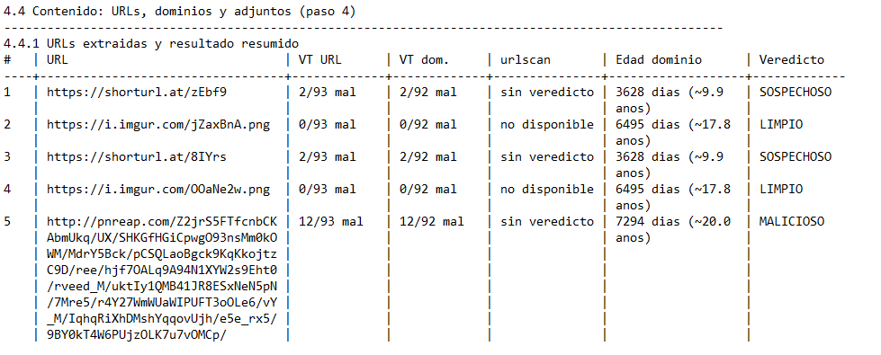

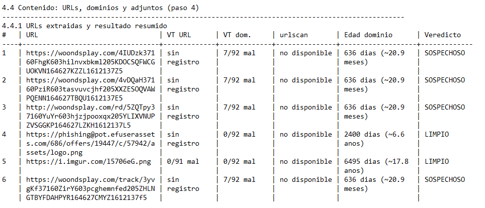

# Conclusiones y controles recomendados

La clasificación propuesta se mantiene en **F001, F002, R004 y U002 maliciosos; R005, U001 y U003 sospechosos**. Los binarios F001/F002 son recursos independientes y no se atribuyen como adjuntos de correos que no los contienen. El ELF relacionado con U002 se documentó mediante una descarga histórica de terceros; no se descargó en nuestro entorno ni es uno de los PE del ZIP.

La medida inmediata es evitar interacción con los recursos, conservarlos aislados y reportar los indicadores. La organización debería bloquear indicadores confirmados mediante controles de seguridad, revisar telemetría de accesos/descargas y decidir acciones de respuesta cuando exista evidencia de afectación. No se recomienda bloquear rangos completos de proveedores compartidos por aparecer en una cadena o un recurso externo.

## Cobertura y limitaciones

| Requisito o aspecto | Resultado y límite |
| :--- | :--- |
| Hash y reputación de archivos | Tres huellas locales, tipo, tamaño y reporte existente de VT; sin subida |
| Identidades y autenticación de correo | Cabeceras y alineación analizadas; no se revalidó DKIM criptográficamente ni se reconstruyó SPF histórico |
| Blacklist de las IP | MXToolbox completado: R004, 0 listados y 1 timeout entre 60 listas; R005, 0 listados y 0 timeouts entre 60 listas |
| Contenido de correo | MIME decodificado como datos; sin adjuntos, renderizado HTML ni carga de imágenes |
| Históricos de enlaces de correo | La revisión exacta de cinco URLs no devolvió resultados en esa adquisición; no acredita ausencia global de históricos ni limpieza |
| URLs independientes | Reportes exactos existentes, capturas, IP/país, redirecciones, dominios contactados, RDAP/DNS/CT según pertinencia |
| Destinos posteriores | No se siguieron los acortadores ni el enlace externo de login de U001; no se confirma captación de credenciales |
| Comportamiento ejecutado | No realizado; solo evidencia estática e informes de terceros |
| VM / snapshot | Invitado mínimo derivado de Kali y recuperación por base/diferencial; no se acredita snapshot formal de hipervisor |
| Recurso legítimo | No acreditado. No se fuerza un resultado para cubrir el guion sugerido |

La consigna permite que el set incluya un legítimo; no obliga a fabricar uno. Tres recursos permanecen sospechosos porque la evidencia no permite declararlos limpios ni confirmar todos los comportamientos maliciosos. Este informe expresa esas limitaciones para que puedan defenderse y revisarse.

## Anexo de fuentes y reproducibilidad

- [Respuestas originales de VT de archivos](archivos-reputacion.json) y [salida Markdown del análisis](archivos-reputacion.md).
- [Huellas y tipos calculados en VM](primarios/vm/grupo05-archivos-estaticos.json).
- [Registro de extracción estática AES](primarios/vm/grupo05-aes-consola.log).
- [Extracción estática de correos](correos-estaticos.json) y [resumen HTML](correos-html-resumen.json).
- [Registro de exportación verificada de correos](primarios/vm/grupo05-correos-verificados-consola.log).
- [Reputación de remitentes/IP](correos-reputacion.json) y [reputación de enlaces de correo](enlaces-correo-reputacion.json).
- [MXToolbox: adquisición y resultados](cierre/mxtoolbox-adquisicion.json), [texto R004](cierre/R004-mxtoolbox-texto.txt) y [texto R005](cierre/R005-mxtoolbox-texto.txt).
- [Revisión exacta posterior de URL de correos](cierre/urlscan-correo-revision-exacta.json).
- [Resumen normalizado de las tres URLs, con referencias a sus respuestas originales](urls/20261023T180740Z/resumen-normalizado.json).
- [Consulta del hash de descarga histórica de U002](urls/20261023T180740Z/U002-archivo-reputacion.json).
- [Capturas: fuentes, fechas y huellas](capturas/registro-capturas.json).
- [Manifiesto local vigente](manifiesto-evidencias.json) y [lista de verificación SHA-256](SHA256SUMS). Es un control local de integridad, no una firma ni un sellado de tiempo externo.

Referencias de interpretación: [VirusTotal: archivos](https://docs.virustotal.com/reference/files), [urlscan: búsqueda](https://docs.urlscan.io/pages/search-api-reference), [urlscan: detalle](https://docs.urlscan.io/pages/result-api-reference), [DMARC y alineación: RFC 9989](https://www.rfc-editor.org/rfc/rfc9989.html). Consigna: documento docente aportado por el grupo, UTN-FRRe, ciclo 2026.
