# Grupo 05 — fichas de las tres URLs

## Alcance y procedencia

Las tres URLs provienen de R006 / url.txt, SHA-256 `972f6f2322a6bce4e1adfdfea8fde8d0d76f357a8855c064e8cc0c734cd91125`. Se consultaron informes y datos públicos existentes; no se visitaron destinos sospechosos, descargaron cargas ni solicitaron escaneos nuevos. Las IP, HTTP y contenidos históricos son observaciones de terceros del 16/10/2026, distintas del estado DNS/registral consultado el 23/10/2026.

Las búsquedas exactas con canonical.page.url no devolvieron resultados. Se amplió al host/IP y se seleccionaron localmente únicamente task.url idénticos a la URL del recurso. No se atribuyen al recurso los resultados de otras rutas de la misma IP. Se conserva la búsqueda vacía y la ampliada. La ausencia inicial no demuestra ausencia de históricos. El detalle U001 sin clave respondió 403; una consulta posterior autenticada tuvo éxito.

Los veredictos urlscan son discordantes: overall.malicious=false y urlscan.hasVerdicts=false en los tres reportes; el bloque engines informa malicious=true para U001/U003 y false para U002. Se preservan todas las señales y no se traduce false/sin clasificación a limpio. Las detecciones de VT no son votos estadísticamente independientes.

[Resumen normalizado con referencias](urls/20261023T180740Z/resumen-normalizado.json). [Registro de capturas](capturas/registro-capturas.json).

## U001 — `hxxps://g-comeceseuatendimenton[.]shop/`

**Clasificación propuesta: SOSPECHOSO. Confianza: Media.**

Fuentes: [consultas originales](urls/20261023T180740Z/U001.json), [informe detallado histórico](urls/20261023T180740Z/U001-urlscan-detalle-autenticado-01a1462b-bbda-773d-a9b2-fa0511ed4b52.json). Adquisición UTC: 2026-10-23T18:07:40.710075+00:00.

### Reputación y observación histórica

- VT de la URL exacta: {"malicious": 2, "suspicious": 0, "undetected": 36, "harmless": 55, "timeout": 0}. Último análisis UTC: 2026-10-16T20:33:02+00:00.
- Etiquetas de motores: `ESET: phishing`, `LevelBlue: phishing`.
- urlscan: 2026-10-16T19:24:00.159Z; título `Consulta de Informações Financeiras`; IP `88[.]80[.]17[.]232`; país informado SE; HTTP 200. La geolocalización no identifica al operador.
- Dominios contactados por el escaneo: `g-comeceseuatendimenton[.]shop`, `fonts[.]gstatic[.]com`, `ipapi[.]co`, `fonts[.]googleapis[.]com`. No implica que todos sean maliciosos.
- Redirecciones: lista vacía en el detalle urlscan; VT informa URL final `hxxps://g-comeceseuatendimenton[.]shop/`. Esto describe esos reportes, no garantiza ausencia de redirecciones en otro momento.

La captura archivada muestra una oferta de orientación sobre información de CPF con temporizador y botón “Acessar orientações”. Incluye avisos de contenido educativo y de no ser institución financiera; esas afirmaciones pertenecen al sitio y no se validaron. No se observa en esa captura un formulario para introducir credenciales. El detalle registra un enlace saliente hacia `hxxps://feiraoaberto[.]netlify[.]app/login/`: un enlace no es una redirección ni prueba de envío de datos. No se siguió.

Dos motores de VT etiquetan phishing; el título/temática y el enlace saliente sostienen sospecha de ingeniería social. No se confirma captación de credenciales, exfiltración ni una entidad suplantada.

### Registro, DNS y certificados

- Registro: 2026-07-29T13:23:01.0Z; antigüedad aproximada a la consulta: 86 días. Registrar: Dynadot Inc.
- Estados RDAP: `server hold`, `client transfer prohibited`.
- NS según RDAP: `ns1[.]dyna-ns[.]net`, `ns2[.]dyna-ns[.]net`.
- DNS actual: RCODE 3 (NXDOMAIN) en los tipos consultados. No se presenta como limpio ni contradice la existencia de históricos. No se atribuye una causa de suspensión; los estados hold/inactive se conservan como contexto.
- Nombres observados en CT: `g-comeceseuatendimenton[.]shop`.

  Certificado/entrada 28359107479: `g-comeceseuatendimenton[.]shop`; 2026-07-29T18:47:32 a 2026-10-27T18:47:31; emisor `C=US, O=Let's Encrypt, CN=YR2`.
  Certificado/entrada 28359104673: `g-comeceseuatendimenton[.]shop`; 2026-07-29T18:47:32 a 2026-10-27T18:47:31; emisor `C=US, O=Let's Encrypt, CN=YR2`.

Las entradas duplicadas de pre-certificado/certificado no cuentan como dominios distintos. El registro CT no prueba que el servidor actual use ese certificado ni que el sitio sea legítimo. La vigencia anotada es la declarada por la entrada; no se probó una conexión TLS al destino. Para U001 se conservó el timeout inicial y luego se obtuvo la consulta de subdominios.

Certificado principal según el histórico urlscan: g-comeceseuatendimenton.shop, emisor YR1; válido de 2026-09-25T22:34:26+00:00 a 2026-12-24T22:34:25+00:00. Es una observación de ese escaneo y puede diferir de las entradas CT enumeradas; no se verificó el certificado actual ni se infiere legitimidad.

### Impacto y medidas

**Confidencialidad potencial:** riesgo de revelar información al interactuar con un recurso sospechoso o su destino enlazado; no se observó envío de credenciales. **Integridad/disponibilidad:** sin efecto demostrado. **Usuario:** evitar interacción y verificar por un canal oficial independiente. **Organización:** aplicar filtrado y revisión contextual de indicadores; no bloquear dominios de infraestructura compartida por aparecer como recursos de terceros.

### Evidencia visual

captura de vista local derivada. Captura UTC: 2026-10-23T18:15:49.369277+00:00.

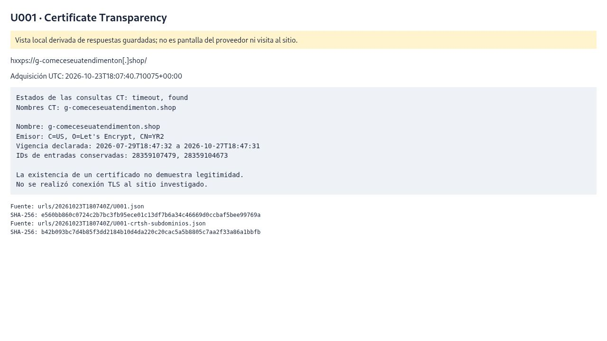

captura de vista local derivada. Captura UTC: 2026-10-23T18:15:48.813274+00:00.

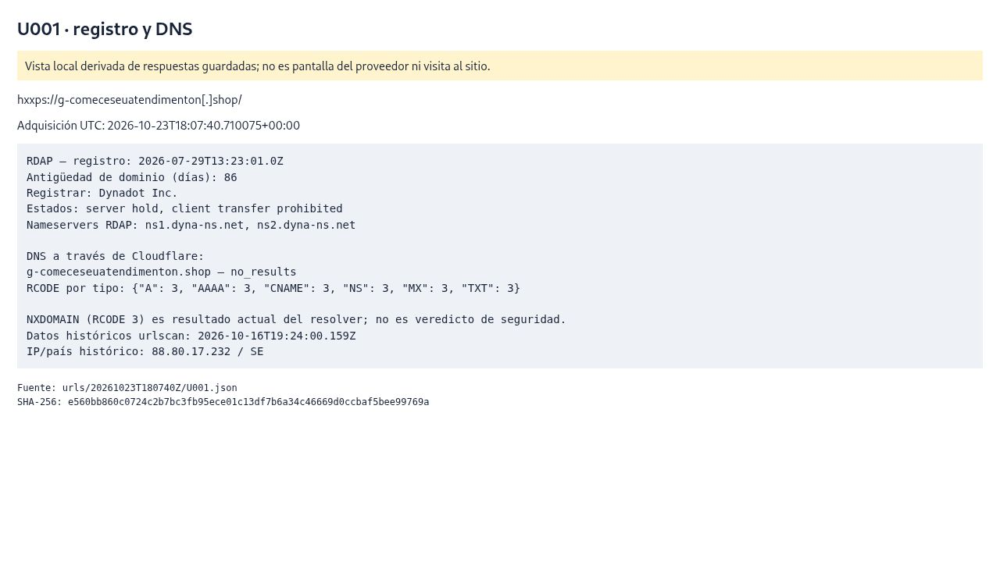

captura de imagen histórica de tercero. Captura UTC: 2026-10-23T18:10:20.158327+00:00.

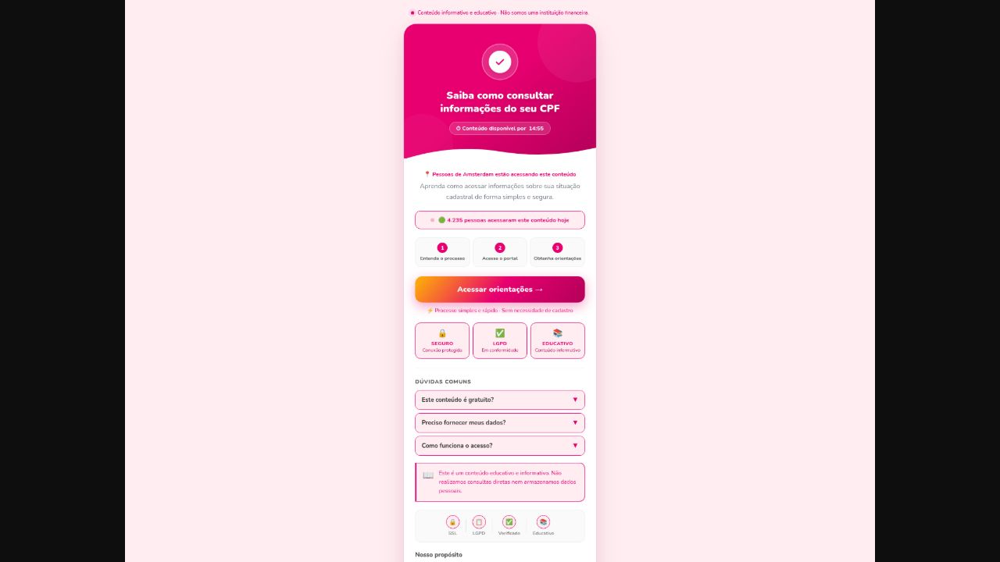

captura externa real. Captura UTC: 2026-10-23T18:09:43.386198+00:00.

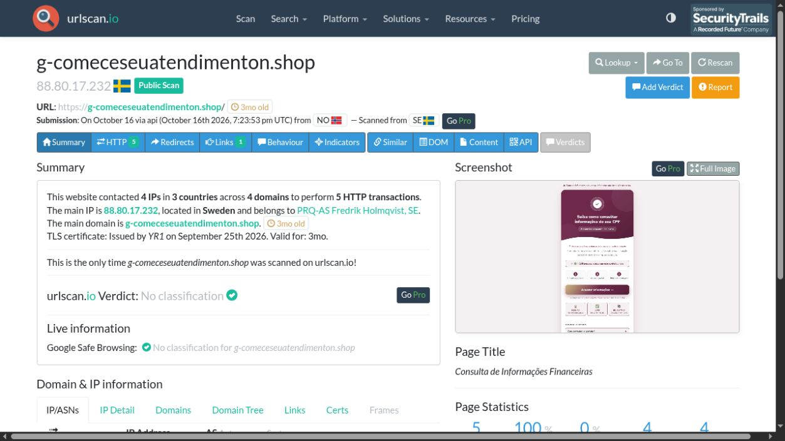

captura externa real. Captura UTC: 2026-10-23T18:09:05.390073+00:00.

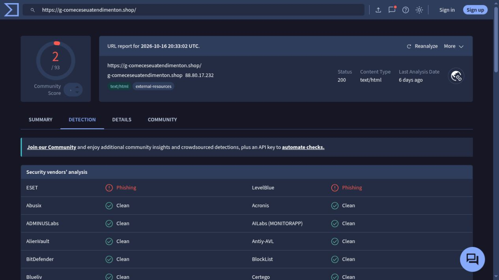

Los JPEG son capturas reales del navegador. Los que terminan en “local” muestran datos derivados de JSON y lo indican en pantalla; no son imágenes del proveedor ni del sitio. Las imágenes “archivada” corresponden a capturas ya existentes de urlscan, no a visitas actuales.

## U002 — `hxxp://221[.]15[.]173[.]51:41661/bin[.]sh`

**Clasificación propuesta: MALICIOSO. Confianza: Alta en reputación y asociación histórica al binario; sin ejecución propia.**

Fuentes: [consultas originales](urls/20261023T180740Z/U002.json), [informe detallado histórico](urls/20261023T180740Z/U002-urlscan-detalle-autenticado-01a1464c-f4e2-70ba-8c0c-131c9851a684.json). Adquisición UTC: 2026-10-23T18:08:05.447916+00:00.

### Reputación y observación histórica

- VT de la URL exacta: {"malicious": 4, "suspicious": 3, "undetected": 33, "harmless": 53, "timeout": 0}. Último análisis UTC: 2026-10-16T19:48:07+00:00.
- Etiquetas de motores: `alphaMountain[.]ai: suspicious`, `Emsisoft: malware`, `Fortinet: malware`, `GreyNoise: malicious`, `Gridinsoft: suspicious`, `SOCRadar: suspicious`, `Webroot: malicious`.
- urlscan: 2026-10-16T20:00:43.057Z; título no informado; IP `221[.]15[.]173[.]51`; país informado CN; HTTP 200. La geolocalización no identifica al operador.
- Dominios contactados por el escaneo: ninguno; acceso a IP literal. No implica que todos sean maliciosos.
- Redirecciones: lista vacía en el detalle urlscan; VT informa URL final `hxxp://221[.]15[.]173[.]51:41661/bin[.]sh`. Esto describe esos reportes, no garantiza ausencia de redirecciones en otro momento.

El histórico documenta una descarga completada llamada `bin.sh`: 137480 bytes, descrita como **ELF 32-bit MIPS**, no como script shell. El MIME HTTP reportado como application/zip no determina el formato real. El SHA-256 de descarga coincide con el hash de contenido HTTP de VT y con un informe de archivo separado:

`f6c97b1e2ed02578ca1066c8235ba4f991e645f89012406c639dbccc6582eec8`

Ese informe existente informa **50 motores maliciosos**, tipo ELF y tamaño idéntico. Etiqueta popular: `trojan.mirai/mozi`; son atribuciones del servicio, no una familia determinada mediante análisis propio. La combinación de descarga histórica, identidad por hash y reputación respalda clasificación maliciosa con alta confianza. No se descargó ni ejecutó ese binario; tampoco pertenece a los dos Windows PE del ZIP.

[Reputación del hash asociado](urls/20261023T180740Z/U002-archivo-reputacion.json). Último análisis del archivo UTC: 2026-10-13T21:17:41+00:00. No se deducen procesos, persistencia o DDoS ejecutados a partir de esas etiquetas.

### Registro, DNS y certificados

La URL usa una IP literal por HTTP y puerto 41661. Antigüedad/registrador/NS de dominio y certificados HTTPS de dominio no aplican a este recurso. El RDAP de red registra `UNICOM-HA`, país CN, bloque `221[.]13[.]128[.]0`–`221[.]15[.]255[.]255`. Su fecha de asignación 2008-09-04T06:52:49Z no equivale a antigüedad de una campaña.

### Impacto y medidas

**C-I-A potencial:** la distribución de un ejecutable con reputación maliciosa supone riesgo para integridad y confidencialidad si llega a ejecutarse en un sistema compatible. Las etiquetas de botnet/DDoS justifican evaluar disponibilidad como hipótesis, sin afirmar ataques observados. **Usuario:** no descargar ni ejecutar. **Organización:** bloquear URL/hash y revisar telemetría de accesos o descargas; investigar solo si hay indicios de afectación.

### Evidencia visual

captura de vista local derivada. Captura UTC: 2026-10-23T18:16:30.826627+00:00.

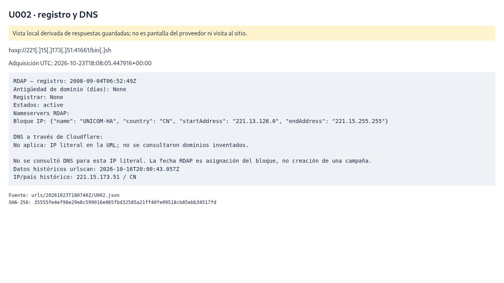

captura externa real. Captura UTC: 2026-10-23T18:12:57.786950+00:00.

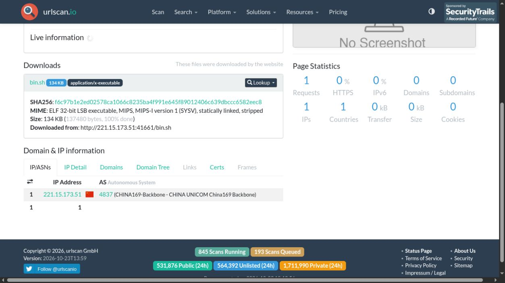

captura externa real. Captura UTC: 2026-10-23T18:11:21.878559+00:00.

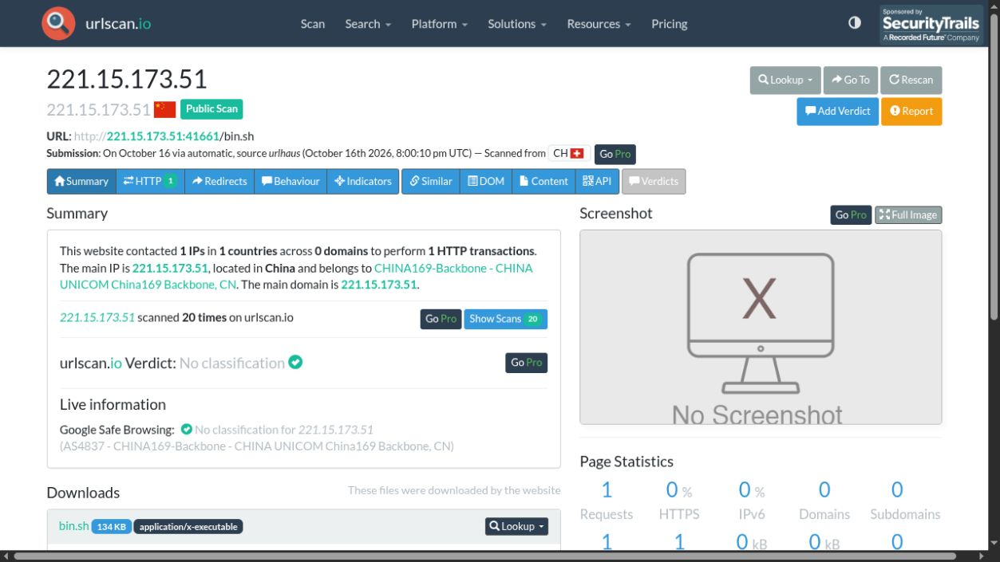

captura externa real. Captura UTC: 2026-10-23T18:12:55.714941+00:00.

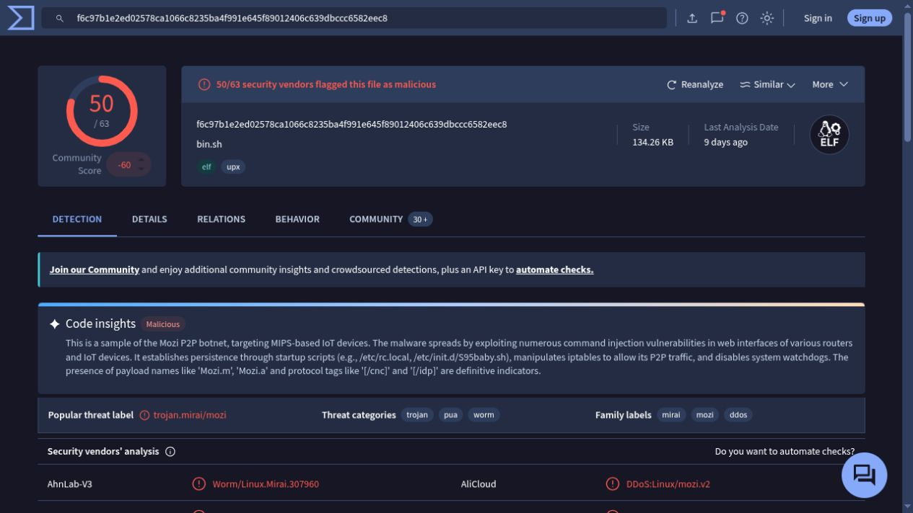

captura externa real. Captura UTC: 2026-10-23T18:11:14.990532+00:00.

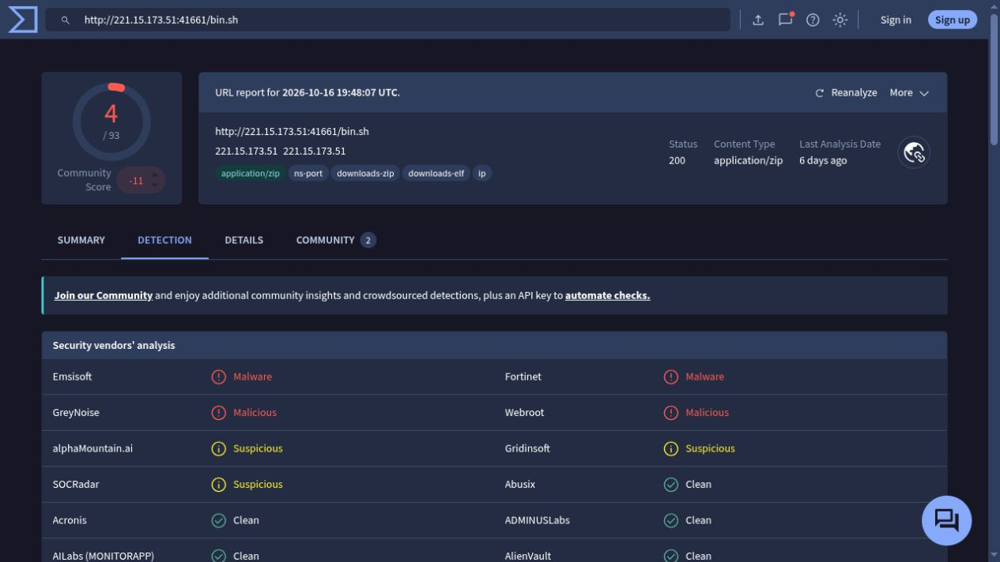

Los JPEG son capturas reales del navegador. Los que terminan en “local” muestran datos derivados de JSON y lo indican en pantalla; no son imágenes del proveedor ni del sitio. Las imágenes “archivada” corresponden a capturas ya existentes de urlscan, no a visitas actuales.

## U003 — `hxxps://www[.]pneustorebr[.]cfd/`

**Clasificación propuesta: SOSPECHOSO. Confianza: Media.**

Fuentes: [consultas originales](urls/20261023T180740Z/U003.json), [informe detallado histórico](urls/20261023T180740Z/U003-urlscan-detalle-autenticado-01a1460d-11c6-71b9-9818-3caec90d10c7.json). Adquisición UTC: 2026-10-23T18:08:38.818631+00:00.

### Reputación y observación histórica

- VT de la URL exacta: {"malicious": 1, "suspicious": 0, "undetected": 35, "harmless": 57, "timeout": 0}. Último análisis UTC: 2026-10-16T20:47:16+00:00.
- Etiquetas de motores: `ESET: phishing`.
- urlscan: 2026-10-16T18:50:34.640Z; título `Domain registered \| Dynadot`; IP `54[.]215[.]31[.]113`; país informado US; HTTP 404. La geolocalización no identifica al operador.
- Dominios contactados por el escaneo: `widget[.]trustpilot[.]com`, `fonts[.]cdnfonts[.]com`, `www[.]pneustorebr[.]cfd`, `oss[.]dynadot[.]com`. No implica que todos sean maliciosos.
- Redirecciones: lista vacía en el detalle urlscan; VT informa URL final `hxxps://www[.]pneustorebr[.]cfd/`. Esto describe esos reportes, no garantiza ausencia de redirecciones en otro momento.

urlscan muestra una página de dominio aparcado “Domain registered | Dynadot” y HTTP 404. VT, en otro horario, reporta HTTP 200 y una IP distinta: se conservan ambos resultados sin inventar una causa. La URL exacta tiene una detección de phishing; el dominio raíz tiene seis maliciosas y dos sospechosas en su consulta separada. El dominio raíz no se confunde con la URL www.

No se observó en ese histórico una tienda ni un formulario de credenciales. El parecido del nombre con una marca no prueba suplantación. Se propone sospechoso por las alertas y el contexto; no se afirma fraude de una tienda demostrado por la página aparcada.

### Registro, DNS y certificados

- Registro: 2026-09-04T03:47:46.0Z; antigüedad aproximada a la consulta: 49 días. Registrar: Dynadot Inc.
- Estados RDAP: `server transfer prohibited`, `client hold`, `client transfer prohibited`, `inactive`.
- NS según RDAP: no incluidos en la respuesta.
- DNS actual: RCODE 3 (NXDOMAIN) en los tipos consultados. No se presenta como limpio ni contradice la existencia de históricos. No se atribuye una causa de suspensión; los estados hold/inactive se conservan como contexto.
- Nombres observados en CT: `pneustorebr[.]cfd`, `www[.]pneustorebr[.]cfd`.

  Certificado/entrada 29336333368: `pneustorebr[.]cfd`; 2026-09-04T07:31:13 a 2026-12-03T07:31:12; emisor `C=US, O=Let's Encrypt, CN=YR2`.
  Certificado/entrada 29676156333: `pneustorebr[.]cfd`; 2026-09-04T07:31:13 a 2026-12-03T07:31:12; emisor `C=US, O=Let's Encrypt, CN=YR2`.
  Certificado/entrada 29336334494: `www[.]pneustorebr[.]cfd`; 2026-09-04T07:31:13 a 2026-12-03T07:31:12; emisor `C=US, O=Let's Encrypt, CN=YR1`.
  Certificado/entrada 29808327070: `www[.]pneustorebr[.]cfd`; 2026-09-04T07:31:13 a 2026-12-03T07:31:12; emisor `C=US, O=Let's Encrypt, CN=YR1`.

Las entradas duplicadas de pre-certificado/certificado no cuentan como dominios distintos. El registro CT no prueba que el servidor actual use ese certificado ni que el sitio sea legítimo. La vigencia anotada es la declarada por la entrada; no se probó una conexión TLS al destino. Para U001 se conservó el timeout inicial y luego se obtuvo la consulta de subdominios.

Certificado principal según el histórico urlscan: *.dynadot.com, emisor GlobalSign GCC R6 AlphaSSL CA 2025; válido de 2025-10-18T00:00:00+00:00 a 2026-11-18T23:59:59+00:00. Es una observación de ese escaneo y puede diferir de las entradas CT enumeradas; no se verificó el certificado actual ni se infiere legitimidad.

### Impacto y medidas

**Confidencialidad potencial:** riesgo de revelar información al interactuar con un recurso sospechoso o su destino enlazado; no se observó envío de credenciales. **Integridad/disponibilidad:** sin efecto demostrado. **Usuario:** evitar interacción y verificar por un canal oficial independiente. **Organización:** aplicar filtrado y revisión contextual de indicadores; no bloquear dominios de infraestructura compartida por aparecer como recursos de terceros.

### Evidencia visual

captura de vista local derivada. Captura UTC: 2026-10-23T18:15:50.221281+00:00.

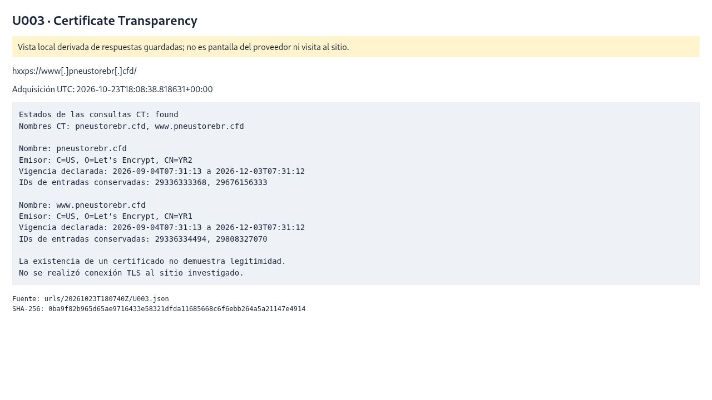

captura de vista local derivada. Captura UTC: 2026-10-23T18:15:49.937280+00:00.

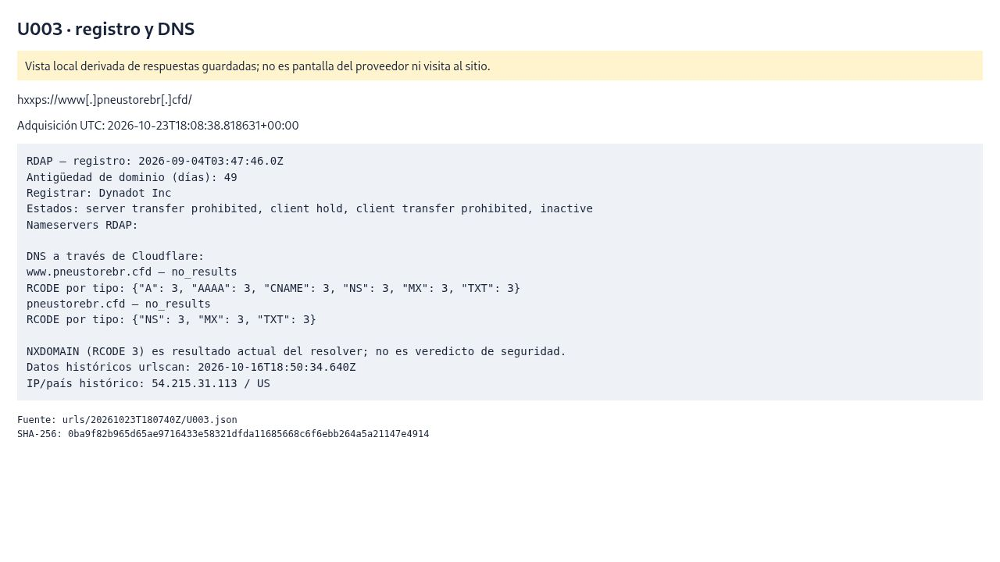

captura de imagen histórica de tercero. Captura UTC: 2026-10-23T18:12:18.842788+00:00.

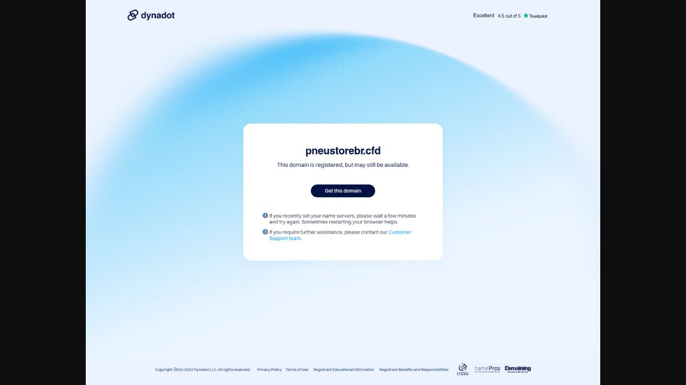

captura externa real. Captura UTC: 2026-10-23T18:12:18.466786+00:00.

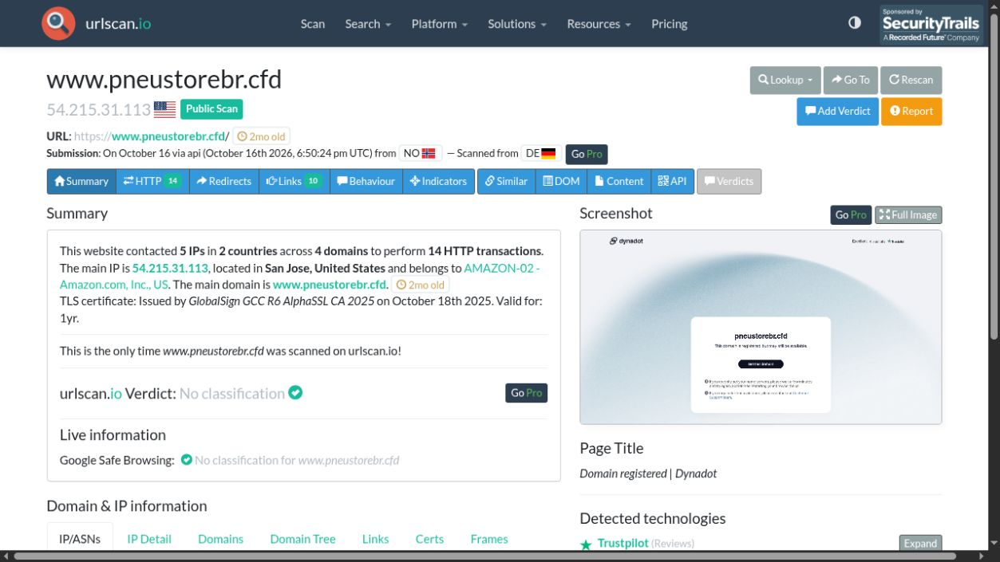

captura externa real. Captura UTC: 2026-10-23T18:17:10.546679+00:00.

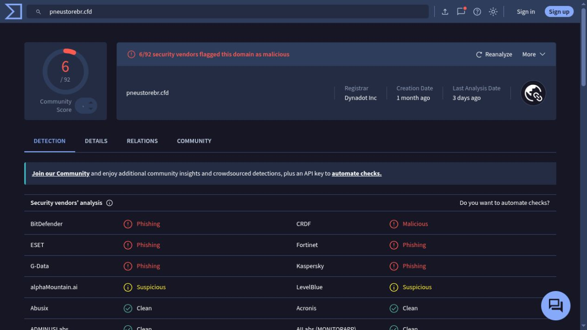

captura externa real. Captura UTC: 2026-10-23T18:12:07.194740+00:00.

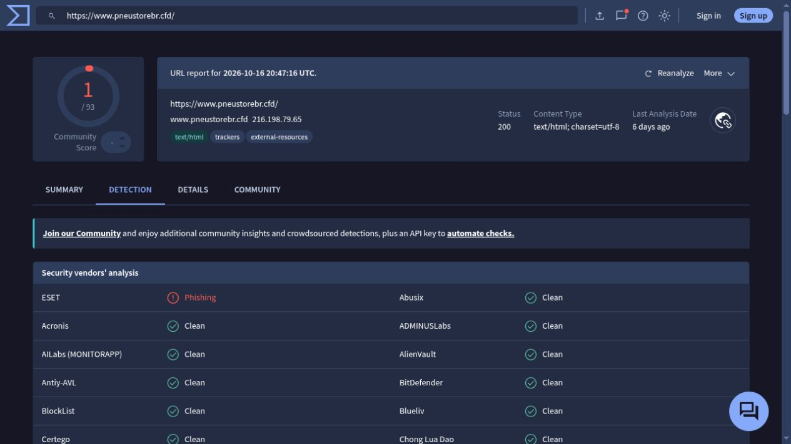

Los JPEG son capturas reales del navegador. Los que terminan en “local” muestran datos derivados de JSON y lo indican en pantalla; no son imágenes del proveedor ni del sitio. Las imágenes “archivada” corresponden a capturas ya existentes de urlscan, no a visitas actuales.

## Límites de este bloque

Los tres recursos fueron revisados con datos existentes. No se verificó el sitio actual ni se ejecutó contenido. No se siguió el enlace de login externo de U001. El archivo de U002 no se descargó. Los hallazgos no prueban infección del equipo ni autoría de operadores. Las diferencias de DNS, HTTP, IP, TLS y veredictos se conservan con su fecha y alcance.
